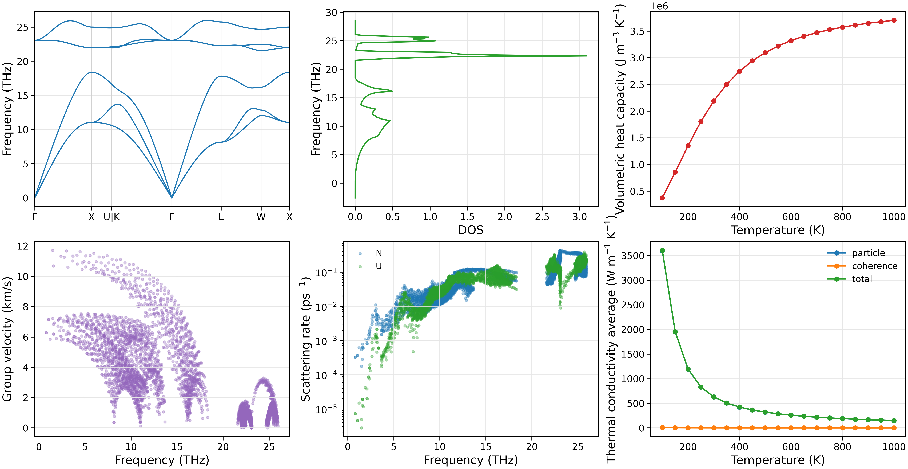

Quick start: three-phonon thermal transport
===========================================

Using the bundled 3C-SiC NEP potential, this example relaxes the structure,
generates second- and third-order force constants (FC2/FC3), and calculates
three-phonon RTA thermal transport.

Prepare a working directory
---------------------------

Run from the NEP-kappa repository root:

.. code-block:: bash

   conda activate nepkappa
   mkdir -p ~/work/3C-SiC
   cp examples/structures/3C-SiC/POSCAR_primitive ~/work/3C-SiC/POSCAR
   cp examples/potentials/3C-SiC/nep_3C-SiC.txt ~/work/3C-SiC/
   cd ~/work/3C-SiC

The working directory contains the structure ``POSCAR`` and the NEP potential
``nep_3C-SiC.txt``. Relative input paths are resolved from the launch directory.

Configure the input
------------------------

Create ``input.yaml``:

.. code-block:: yaml

   structure:
     poscar: POSCAR
     relaxation: true

   calculator:
     name: nep
     model: nep_3C-SiC.txt

   force-constant:
     dim-fc2: [3, 3, 3]
     dim-fc3: [3, 3, 3]

   kappa:
     engine: phono3py
     mesh: [31, 31, 31]
     temps: [100, 1000, 50]
     method: rta
     isotope: true
     wigner: true

   plot:
     layout: both
     path: seekpath
     tau: total
     temperature: 300
     kappa: x
     dpi: 300

   output:
     result-dir: results

.. note::

   These settings demonstrate the workflow. For research calculations, check
   convergence with respect to the force-constant supercells ``dim-fc2`` and
   ``dim-fc3`` and the q mesh ``mesh``.

Run the calculation
------------------------

Check the input:

.. code-block:: bash

   nepkappa info input.yaml --for run

After checking the configuration, run the complete calculation:

.. code-block:: bash

   nepkappa run input.yaml

The workflow performs structure relaxation, FC2/FC3 generation and thermal
transport in sequence. Progress is shown in the terminal and the detailed log
is saved to ``results/run.log``.

Add ``-v`` for detailed terminal output:

.. code-block:: bash

   nepkappa run input.yaml -v

Inspect the results
------------------------

After the calculation, generate plots and reports:

.. code-block:: bash

   nepkappa plot input.yaml
   nepkappa report input.yaml

The main results are saved in ``results/``:

.. list-table::
   :header-rows: 1
   :widths: 35 65

   * - File
     - Contents
   * - ``fc2.hdf5`` / ``fc3.hdf5``
     - Second- and third-order force constants.
   * - ``phono3py_disp.yaml``
     - Displacement structures and force-constant metadata.
   * - ``kappa-m313131.hdf5``
     - Conductivity and mode-resolved transport data.
   * - ``plots/``
     - Phonon-property and thermal-transport plots.
   * - ``report.md`` / ``report.yaml``
     - Result summaries.

``layout: both`` generates individual plots and ``combined.png``, covering
dispersion, DOS, volumetric constant-volume heat capacity, group velocities,
phonon scattering rates and lattice thermal conductivity.

Wigner conductivity plots distinguish the particle, coherence and total contributions.

   Phonon properties and thermal transport of 3C-SiC: dispersion, DOS,
   heat capacity, group velocities, scattering rates and conductivity.

See :doc:`temperature` for temperature-dependent phonons and
:doc:`thermal_transport` for further transport examples.
