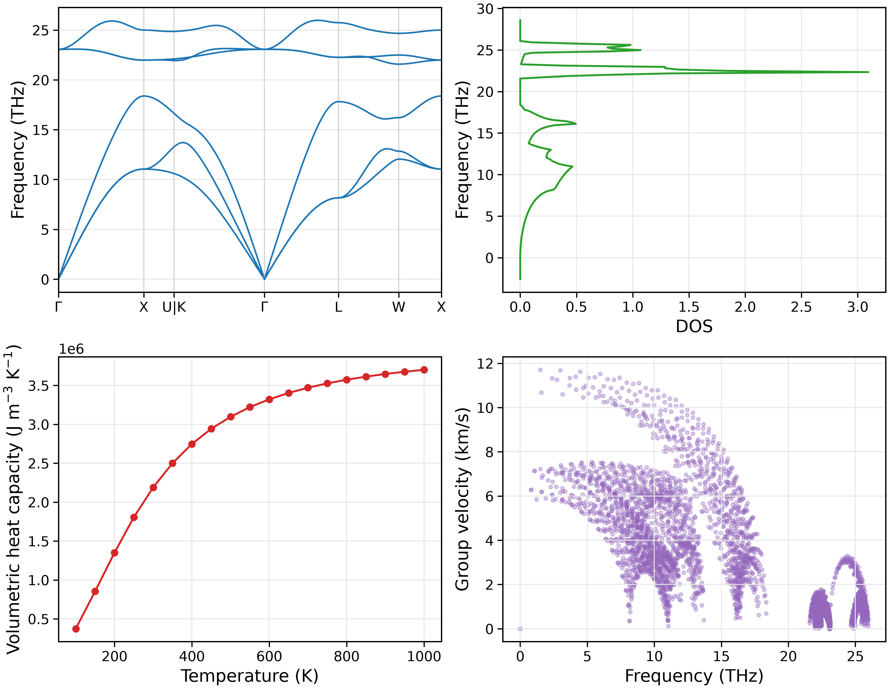

Quick start: phonon spectra
===========================

This tutorial uses the bundled 3C-SiC NEP potential to relax the structure,
generate second-order force constants (FC2), and calculate phonon dispersion,
density of states (DOS), volumetric constant-volume heat capacity and group velocities.

This chapter covers harmonic phonon properties; it does not calculate phonon
scattering or lattice thermal conductivity.

Prepare a working directory
---------------------------

Run from the NEP-kappa repository root:

.. code-block:: bash

   conda activate nepkappa
   mkdir -p ~/work/3C-SiC
   cp examples/structures/3C-SiC/POSCAR_primitive ~/work/3C-SiC/POSCAR
   cp examples/potentials/3C-SiC/nep_3C-SiC.txt ~/work/3C-SiC/
   cd ~/work/3C-SiC

The working directory contains the structure ``POSCAR`` and the NEP potential
``nep_3C-SiC.txt``. Relative input paths are resolved from the directory where
the command is launched.

Configure the input
------------------------

Create ``phonons.yaml`` in the working directory:

.. code-block:: yaml

   structure:
     poscar: POSCAR
     relaxation: true

   calculator:
     name: nep
     model: nep_3C-SiC.txt

   force-constant:
     dim-fc2: [3, 3, 3]

   kappa:
     mesh: [31, 31, 31]
     temps: [100, 1000, 50]

   plot:
     layout: both
     path: seekpath
     dpi: 300

   output:
     result-dir: results/phonons

This example generates FC2 in a 3×3×3 supercell and uses a 31×31×31 q mesh
for the DOS and thermodynamic properties. Heat capacity is evaluated from
100 to 1000 K in 50 K increments.

Here, ``kappa`` supplies only the q mesh and temperature settings needed for
phonon properties and plotting. The direct ``fc2`` command does not run
phonon-scattering or conductivity calculations.

Run the calculation
------------------------

First check the input and relax the structure:

.. code-block:: bash

   nepkappa info phonons.yaml --for relax
   nepkappa relax phonons.yaml

Then generate second-order force constants:

.. code-block:: bash

   nepkappa info phonons.yaml --for fc2
   nepkappa fc2 phonons.yaml

Finally, plot the phonon properties:

.. code-block:: bash

   nepkappa info phonons.yaml --for plot
   nepkappa plot phonons.yaml

The log is saved to ``results/phonons/run.log``. Append ``-v`` to a calculation
command to show detailed terminal output.

Inspect the results
------------------------

Check the force constants and plots:

.. code-block:: bash

   ls -lh results/phonons/fc2.hdf5
   ls results/phonons/plots

The main outputs are ``fc2.hdf5``, matching structure and displacement metadata,
and phonon-property plots.

``layout: both`` generates four individual plots and ``combined.png``:

- **Phonon dispersion**: phonon frequencies along high-symmetry paths.
- **Phonon DOS**: the distribution of vibrational states over frequency.
- **Volumetric constant-volume heat capacity**: heat capacity versus temperature.
- **Phonon group velocities**: group velocities of the phonon modes.

``path: seekpath`` determines the high-symmetry dispersion path; ``mesh``
controls Brillouin-zone sampling. They serve different purposes.

   Harmonic properties of 3C-SiC: dispersion, DOS, volumetric constant-volume
   heat capacity and group velocities.

The next chapter, :doc:`starting`, adds third-order force constants (FC3)
to calculate three-phonon scattering and lattice thermal conductivity.
