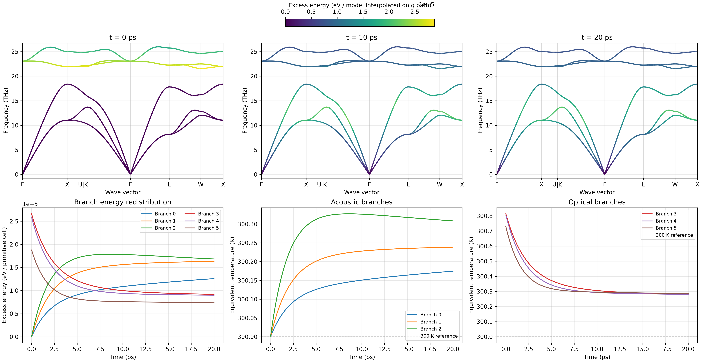

TD-BTE: nonequilibrium phonon excitation and thermalization
===========================================================

NEP-kappa solves the time-dependent phonon Boltzmann transport equation
(TD-BTE) for nonequilibrium populations and energy exchange between modes.
This chapter selectively excites optical phonons in 3C-SiC and follows energy
transfer to the acoustic branches and subsequent thermalization.

The model is spatially homogeneous and includes relaxation due to phonon
collisions. See :doc:`tdbte_spatial` for propagation coupled to collisions.

Calculation method
------------------------

Homogeneous TD-BTE describes the time evolution of mode populations:

.. math::

   \frac{\partial n_\lambda(t)}{\partial t}
   =\mathcal{C}^{3\mathrm{ph}}_\lambda[n(t)].

Here, :math:`n_\lambda` is the population of mode :math:`\lambda`, and
:math:`\mathcal{C}^{3\mathrm{ph}}_\lambda` is the nonlinear three-phonon
collision integral.

Unlike a steady-state conductivity calculation, TD-BTE solves populations
directly and requires no prior conductivity calculation. Phonon frequencies
and three-phonon interaction strengths are fixed while integration tracks
energy redistribution between modes.

Prepare force constants
------------------------

Continue from the Chapter 4 :doc:`starting` working directory:

.. code-block:: bash

   conda activate nepkappa
   cd ~/work/3C-SiC

Check the matching FC2, FC3 and phonon metadata:

.. code-block:: bash

   ls results/fc2.hdf5
   ls results/fc3.hdf5
   ls results/phono3py_disp.yaml

FC2 provides frequencies and vibrational modes, FC3 provides three-phonon
interactions, and ``phono3py_disp.yaml`` supplies the structure and supercell
mappings. These files are reused without recalculating forces or force constants.

Selective optical-phonon excitation
-----------------------------------

The two-atom primitive cell of 3C-SiC has six branches: 0–2 are acoustic and
3–5 are optical. This example increases the initial populations of all three
optical branches by 1%, then follows redistribution through nonlinear collisions.

Configure the input
~~~~~~~~~~~~~~~~~~~~~~~~

Create ``tdbte.yaml`` in the working directory:

.. code-block:: yaml

   tdbte:
     force-constants: results
     mesh: [6, 6, 6]
     temperature: 300
     branches: [3, 4, 5]
     excitation: 0.01
     duration-ps: 20
     max-step-ps: 0.5
     samples: 201

   plot:
     layout: both
     path: seekpath
     tdbte-times: [0, 10, 20]
     dpi: 300

   output:
     result-dir: results/tdbte-optical

The three-dimensional 6×6×6 q mesh contains 216 q points. It is used to build
the collision integral independently of the steady-state transport mesh.
``branches`` selects branches indexed from zero and sorted by frequency at
each q point. ``excitation: 0.01`` multiplies the initial populations by 1.01;
it does not increase the temperature by 1 K.

Initial nonequilibrium distribution
~~~~~~~~~~~~~~~~~~~~~~~~~~~~~~~~~~~

Before excitation, phonons follow a Bose–Einstein equilibrium distribution:

.. math::

   n_\lambda^0(T_0)
   =
   \frac{1}
   {\exp[\hbar\omega_\lambda/(k_{\mathrm B}T_0)]-1}.

Selective excitation produces:

.. math::

   n_\lambda(0)=
   \begin{cases}
   (1+A)n_\lambda^0(T_0), & \lambda\in\mathcal S,\\
   n_\lambda^0(T_0), & \lambda\notin\mathcal S,
   \end{cases}

Here, :math:`\mathcal S` is the selected set of optical modes and
:math:`A=0.01` is the relative excitation amplitude. Other modes retain their
initial equilibrium populations. There is no subsequent external energy input;
energy is exchanged through three-phonon collisions alone.

Run the calculation
------------------------

Check the input and execute TD-BTE:

.. code-block:: bash

   nepkappa info tdbte.yaml --for tdbte
   nepkappa tdbte tdbte.yaml

The program reads force constants, constructs the collision kernel,
initializes nonequilibrium populations and integrates their evolution.
The solver uses adaptive DOP853. ``max-step-ps`` limits the integration step,
while ``samples`` determines the number of saved time points.
Results are saved in ``results/tdbte-optical`` with details in ``run.log``.

Results and analysis
------------------------

Generate plots after the calculation:

.. code-block:: bash

   nepkappa plot tdbte.yaml

``layout: both`` generates six individual plots and one six-panel combined plot.

   Selective optical excitation and thermalization in 3C-SiC. The top row shows
   mode excess energies at different times; the bottom row shows branch energy
   exchange and energy-equivalent acoustic and optical branch temperatures.

Mode energy distributions
~~~~~~~~~~~~~~~~~~~~~~~~~

The top row shows dispersion snapshots at 0, 10 and 20 ps. Frequencies remain
fixed; colors show excess mode energy relative to the initial equilibrium:

.. math::

   \Delta E_\lambda(t)
   =
   \hbar\omega_\lambda
   [n_\lambda(t)-n_\lambda^0(T_0)].

Positive values indicate energy gain relative to the reference equilibrium;
negative values indicate loss. All snapshots use the same color scale to
compare redistribution over time. Mode energies are interpolated from the
q mesh onto the dispersion path for visualization; populations on the path
are not recalculated.

Energy exchange between branches
~~~~~~~~~~~~~~~~~~~~~~~~~~~~~~~~

The lower-left panel shows the excess energy of each of the six branches:

.. math::

   \Delta E_s(t)
   =
   \frac{1}{N_q}\sum_{\mathbf q}
   \hbar\omega_{\mathbf qs}
   [n_{\mathbf qs}(t)-n_{\mathbf qs}^0(T_0)].

Here, :math:`s` is the branch index and energy is in eV per primitive cell.
The optical branches initially carry more excess energy. As time advances,
their excess energy decreases while acoustic branches gain energy through
three-phonon collisions. Without an external heat bath, energy is exchanged
between branches while total energy is conserved.

Energy-equivalent branch temperatures
~~~~~~~~~~~~~~~~~~~~~~~~~~~~~~~~~~~~~

The lower-middle and lower-right panels show acoustic and optical branch
temperatures, defined by matching energies:

.. math::

   E_s(t)=E_s^{\mathrm{BE}}[T_s(t)].

:math:`T_s` is the temperature of a Bose–Einstein distribution with the same
energy as that branch. It does not imply equilibrium within the branch.
Here, optical branch temperatures decrease and acoustic temperatures increase,
reflecting redistribution to other modes.

The injected energy remains in the system, so the final equilibrium
temperature follows from total energy and need not return to the initial
300 K. Branch temperatures may still differ within the finite 20 ps window.

Main outputs
------------------------

.. list-table:: TD-BTE output files
   :header-rows: 1
   :widths: 38 62

   * - File
     - Contents
   * - ``tdbte/trajectories.npz``
     - Populations, times, frequencies and branch indices.
   * - ``tdbte/branch-energy.csv``
     - Excess energy of each branch.
   * - ``tdbte/audit.json``
     - Numerical checks of energy conservation, equilibrium and entropy.
   * - ``plots/tdbte_combined.png``
     - Six-panel nonequilibrium dynamics plot.
   * - ``plots/tdbte_branch_temperature.csv``
     - Energy-equivalent branch temperatures.

Paths are relative to ``results/tdbte-optical``.

Reusing collision kernels
-------------------------

The three-phonon kernel is determined by force constants and the q mesh and
can be reused for different initial excitations. For example, increase the
excitation from 1% to 2% by creating ``tdbte-reuse.yaml``:

.. code-block:: yaml

   tdbte:
     kernel: results/tdbte-optical/tdbte-kernel/manifest.json
     temperature: 300
     branches: [3, 4, 5]
     excitation: 0.02
     duration-ps: 20
     max-step-ps: 0.5
     samples: 201

   output:
     result-dir: results/tdbte-optical-2percent

Run:

.. code-block:: bash

   nepkappa info tdbte-reuse.yaml --for tdbte
   nepkappa tdbte tdbte-reuse.yaml

This reuses the existing kernel without regenerating force constants or
three-phonon collision data. The new trajectories are saved separately.

Model and scope
------------------------

This chapter uses a spatially homogeneous nonlinear three-phonon model with
fixed frequencies to study energy exchange and nonequilibrium relaxation.
It does not include real-space propagation. The next chapter,
:doc:`tdbte_spatial`, adds group velocities and one-dimensional real-space
transport to the same collision model.
