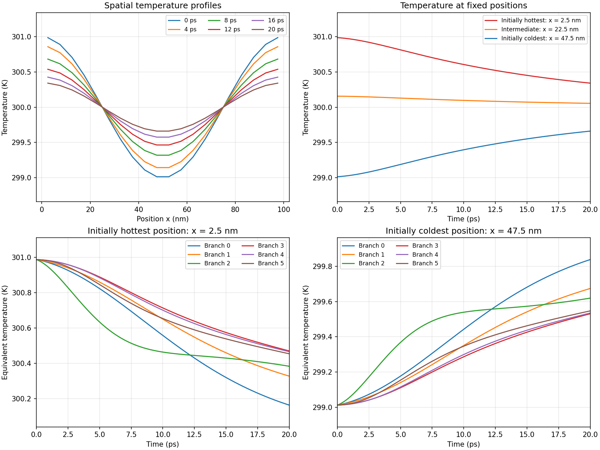

TD-BTE: nonequilibrium phonon transport
=======================================

The previous chapter studied energy exchange with homogeneous TD-BTE.
This chapter adds one real-space coordinate, coupling phonon propagation
to nonlinear three-phonon collisions.

NEP-kappa uses a three-dimensional q mesh and a periodic one-dimensional
real-space mesh to simulate temperature, heat flux and phonon populations
in space and time. A transient thermal grating (TTG) in 3C-SiC illustrates
the input, method and analysis.

Calculation method
------------------------

Spatial TD-BTE contains both drift and collisions:

.. math::

   \frac{\partial n_\lambda(x,t)}{\partial t}
   +
   v_{\lambda,x}
   \frac{\partial n_\lambda(x,t)}{\partial x}
   =
   \mathcal C_\lambda^{3\mathrm{ph}}[n(x,t)].

Here:

- :math:`n_\lambda(x,t)` is the phonon population in space and time.
- :math:`v_{\lambda,x}` is the group-velocity component along transport.
- :math:`\mathcal C_\lambda^{3\mathrm{ph}}` is the nonlinear three-phonon collision integral.

The added drift term describes energy carried by phonons between spatial positions.

.. note::

   One-dimensional refers to the real-space transport coordinate. Phonons
   still use the full three-dimensional q mesh.

Transient thermal gratings
--------------------------

A TTG starts with a periodic temperature distribution:

.. math::

   T(x,0)
   =
   T_0+\Delta T
   \cos\left(\frac{2\pi x}{L}\right).

:math:`T_0` is the background temperature, :math:`\Delta T` the initial
modulation amplitude and :math:`L` the spatial period. Initially, each cell
has a Bose–Einstein distribution at its local temperature. The system then
evolves without continuing external heating as propagation and collisions
change the initial temperature profile.

Prepare the calculation
------------------------

Continue in the previous chapter's working directory:

.. code-block:: bash

   conda activate nepkappa
   cd ~/work/3C-SiC

Check FC2, FC3 and phonon metadata:

.. code-block:: bash

   ls results/fc2.hdf5
   ls results/fc3.hdf5
   ls results/phono3py_disp.yaml

Spatial TD-BTE uses these files for frequencies, group velocities and the
collision kernel. As in the homogeneous model, no prior conductivity
calculation is required.

Configure the input
------------------------

Create ``tdbte-spatial.yaml``:

.. code-block:: yaml

   tdbte:
     force-constants: results
     mesh: [3, 3, 3]
     temperature: 300
     duration-ps: 20.0
     max-step-ps: 0.01
     samples: 201

     spatial:
       length-nm: 100
       cells: 20
       direction: [1, 0, 0]
       boundary: periodic
       cfl: 0.8
       batch-size: 20

       initial:
         profile: ttg
         modes: all
         excitation: temperature
         delta: 1

   plot:
     layout: both
     dpi: 150

   output:
     result-dir: results/tdbte-spatial

The example uses a three-dimensional 3×3×3 q mesh and a periodic 100 nm
real-space domain along x. Twenty cells give a grid spacing of:

.. math::

   \Delta x=\frac{L}{N_x}=5\ \mathrm{nm}.

The initial temperature is a cosine modulation of amplitude 1 K around 300 K.
The simulation lasts 20 ps, saving 201 time points at 0.1 ps intervals.
The figure below uses the same TTG parameters.

Main spatial parameters
~~~~~~~~~~~~~~~~~~~~~~~~

.. list-table:: Spatial TD-BTE parameters
   :header-rows: 1
   :widths: 36 64

   * - Parameter
     - Description
   * - ``length-nm``
     - Length of the one-dimensional periodic domain, in nm.
   * - ``cells``
     - Number of real-space cells.
   * - ``direction``
     - Cartesian vector defining the transport direction.
   * - ``boundary``
     - Spatial boundary condition; currently ``periodic``.
   * - ``cfl``
     - CFL number controlling drift-integration stability.
   * - ``threads``
     - CPU threads for cell-parallel collisions (default 1; requires Numba above 1).
   * - ``batch-size``
     - Number of spatial cells per collision-integral batch.
   * - ``initial``
     - Spatial distribution of the initial temperature or populations.

``length-nm`` and ``cells`` determine real-space resolution, whereas ``mesh``
determines the q mesh and phonon-mode resolution for collisions.

Run the calculation
------------------------

Check the input and run spatial TD-BTE:

.. code-block:: bash

   nepkappa info tdbte-spatial.yaml --for tdbte
   nepkappa tdbte tdbte-spatial.yaml

The program reads force constants and group velocities, builds the collision
kernel and initializes the temperature profile. It then propagates phonons
between cells while evaluating nonlinear collisions inside each cell.
Results are saved in ``results/tdbte-spatial``.

Multicore collision evaluation
-------------------------------

Spatial collisions can run on multiple CPU threads. Set these keys under
``tdbte.spatial``:

.. code-block:: yaml

   threads: 8
   batch-size: 20

Each worker processes independent spatial cells with the same shared event
chunk. Event accumulation within a cell retains its serial order, avoiding
concurrent deposition into the same mode. The default ``threads: 1`` uses
the serial implementation; multiple threads require Numba.

Results and analysis
------------------------

After completion, generate plots and a report:

.. code-block:: bash

   nepkappa plot tdbte-spatial.yaml
   nepkappa report results/tdbte-spatial

Plots are saved in ``results/tdbte-spatial/plots``.

   TTG temperature evolution in 3C-SiC at a background temperature of 300 K
   and an initial modulation amplitude of 1 K, with a 100 nm period,
   20 spatial cells and a 20 ps trajectory. The top row shows spatial profiles
   and total temperatures at three fixed positions. The bottom row shows
   branch temperatures at the initially hottest (x = 2.5 nm) and coldest
   (x = 47.5 nm) positions.

The combined figure is a 2-by-2 temperature plot, using the same line and branch-colour conventions as
homogeneous TD-BTE, without panel-letter annotations:

1. Spatial temperature profiles at six saved times spanning the trajectory.
2. Total temperature versus time at three fixed positions.
3. Branch energy-equivalent temperatures at the initially hottest cell.
4. Branch energy-equivalent temperatures at the initially coldest cell.

The three fixed positions are the initial hottest cell, the cell nearest the
spatial midpoint between the two extrema, and the initial coldest cell.
These cells remain fixed throughout the trajectory. Branch temperatures
are obtained from the saved occupations at the two extrema.

``plot.layout: combined`` writes ``tdbte_spatial.png`` and
``tdbte_spatial.pdf``. ``separate`` writes the four panels individually, and
``both`` writes both layouts. By default the spatial profiles use up to six
evenly spaced saved times; ``plot.tdbte-times`` selects three explicit times.

Temperature evolution in space and time
~~~~~~~~~~~~~~~~~~~~~~~~~~~~~~~~~~~~~~~

Spatial TD-BTE saves populations at each position and time. The program
inverts the total phonon thermal energy in each cell to obtain an
energy-equivalent temperature:

.. math::

   E(x,t)=E_{\mathrm{BE}}[T(x,t)].

:math:`T(x,t)` is a local energy-equivalent temperature; it does not require
local equilibrium within a cell. For TTG initial conditions, follow the
periodic temperature perturbation over time. Its decay depends on propagation,
collisions and spatial length scales.

Main outputs
------------------------

Space- and time-resolved results are saved to:

.. code-block:: text

   results/tdbte-spatial/tdbte/spatial.hdf5

.. list-table:: Main output datasets
   :header-rows: 1
   :widths: 43 57

   * - Dataset
     - Contents
   * - ``occupation``
     - Populations at each position, time and phonon mode.
   * - ``temperature_K``
     - Local energy-equivalent temperature.
   * - ``heat_flux_eV_nm2_ps``
     - Spatially resolved phonon heat flux.
   * - ``branch_energy_eV_nm3``
     - Branch energy densities.
   * - ``branch_heat_flux_eV_nm2_ps``
     - Branch heat fluxes.
   * - ``branch_collision_power_eV_nm3_ps``
     - Branch energy-exchange rates from three-phonon collisions.
   * - ``ttg_cosine_amplitude_K``
     - Fundamental TTG cosine temperature amplitude.
   * - ``departure_from_local_BE``
     - Departure from the local equal-energy Bose distribution.

.. _spatial-initial-conditions:

Independent initial-condition choices
--------------------------------------

``spatial.initial`` separates three independent choices:

.. list-table:: Initial-condition options
   :header-rows: 1
   :widths: 25 35 40

   * - Key
     - Values
     - Meaning
   * - ``profile``
     - ``ttg``, ``gaussian``, ``uniform``
     - Spatial envelope; default ``ttg``.
   * - ``modes``
     - ``all``, ``branches``, ``frequency-window``
     - Mode selection; default ``all``.
   * - ``excitation``
     - ``temperature``, ``relative``
     - Occupation prescription; default ``temperature``.

All 18 combinations are supported. ``uniform`` means spatially uniform;
``all`` means all active modes. Branch and frequency selections apply at
the q points represented in the kernel.

Spatial envelopes and occupations
~~~~~~~~~~~~~~~~~~~~~~~~~~~~~~~~~~~

``profile`` defines the spatial envelope :math:`p(x)`:

- ``ttg``: cosine profile, :math:`p(x)=\cos(2\pi x/L)`.
- ``gaussian``: periodic Gaussian with width ``sigma-nm``, centered at :math:`L/2` by default.
- ``uniform``: spatially uniform, :math:`p(x)=1`.

Temperature excitation sets the selected modes to Bose occupations at
:math:`T_0+\delta p(x)`. Relative excitation multiplies their background
occupations by :math:`1+\delta p(x)`. Unselected modes retain their Bose
occupations at the background temperature :math:`T_0`.

Excitation strength
~~~~~~~~~~~~~~~~~~~~

``excitation`` determines the meaning of ``delta``:

- ``temperature``: temperature perturbation in K, default 1 K.
- ``relative``: dimensionless fractional occupation change, default 0.01 (1%).

For example, ``delta: 0.2`` means 0.2 K or 20%, respectively.

Selective TTG with temperature excitation
~~~~~~~~~~~~~~~~~~~~~~~~~~~~~~~~~~~~~~~~~

Replace ``spatial.initial`` with:

.. code-block:: yaml

   initial:
     profile: ttg
     modes: branches
     branches: [3, 4, 5]  # Zero-based IDs; verify for the material/kernel.
     excitation: temperature
     delta: 10

Set ``modes: all`` and omit ``branches`` for the full-mode thermal TTG.

Gaussian excitation of a frequency window
~~~~~~~~~~~~~~~~~~~~~~~~~~~~~~~~~~~~~~~~~~

.. code-block:: yaml

   initial:
     profile: gaussian
     sigma-nm: 8
     center-nm: 50
     modes: frequency-window
     frequency-range-THz: [10, 15]
     excitation: relative
     delta: 0.2

The frequency window includes both endpoints, with :math:`0\le f_{min}<f_{max}`.
Only active modes in that interval are changed, by up to 20% at the pulse center.
Use ``profile: uniform`` and omit the Gaussian parameters for spatially
uniform excitation. Different windows with the same relative amplitude do
not generally receive the same injected energy.
