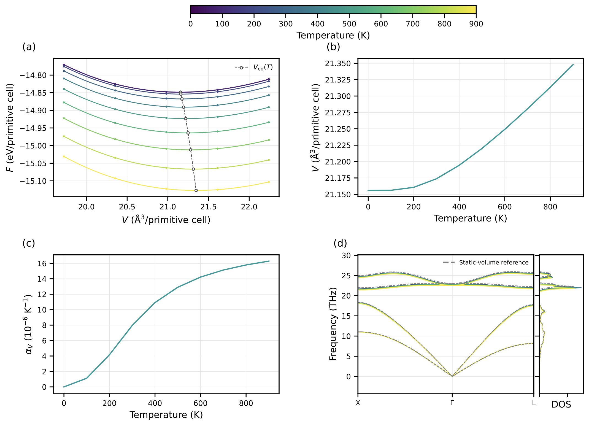
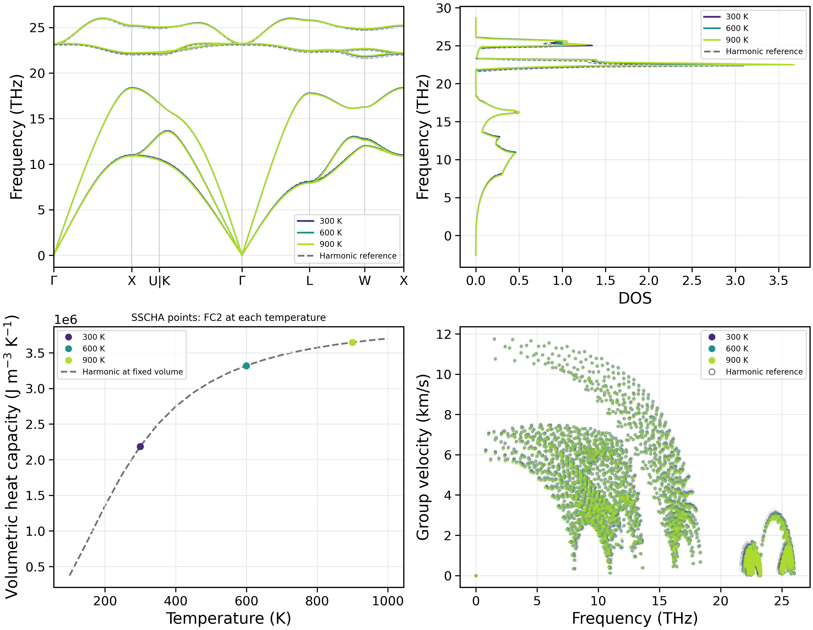
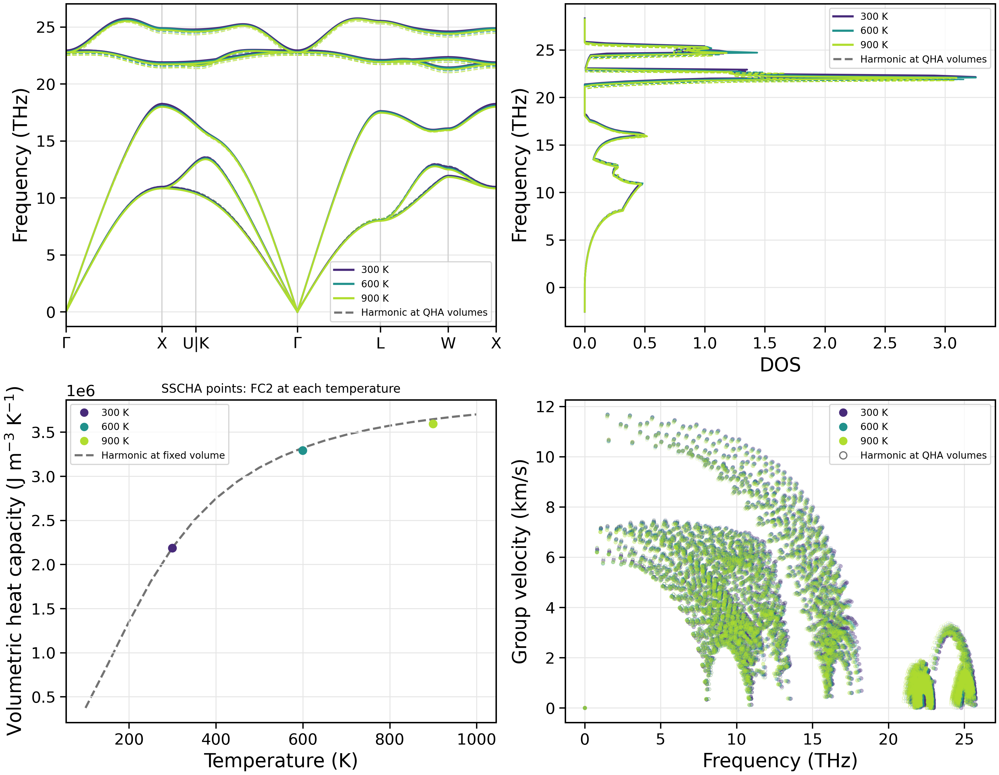

Temperature renormalization of phonons
======================================

This chapter introduces three temperature-dependent phonon methods in NEP-kappa:
the quasi-harmonic approximation (QHA), the stochastic self-consistent harmonic
approximation (SSCHA), and SSCHA at QHA equilibrium volumes.

QHA describes frequency changes caused by thermal expansion. Fixed-volume
SSCHA captures frequency renormalization from anharmonic interactions.
QHA+SSCHA combines the two effects to study temperature-dependent phonon properties.

This chapter does not calculate conductivity. For ordinary harmonic phonons,
see :doc:`starting_phonons`.

Methods and preparation
------------------------

.. list-table:: Temperature-dependent phonon methods
   :header-rows: 1
   :widths: 25 55 20

   * - Method
     - Main calculations
     - Command
   * - QHA
     - Volume scans, thermal expansion and phonons at equilibrium volumes.
     - ``fc2``
   * - SSCHA
     - Anharmonic phonon-frequency renormalization at fixed volume.
     - ``run``
   * - QHA+SSCHA
     - SSCHA at the QHA equilibrium volume for each temperature.
     - ``run``

Continue from the Chapter 3 working directory using the relaxed 3C-SiC structure:

.. code-block:: bash

   conda activate nepkappa
   cd ~/work/3C-SiC
   ls results/phonons/POSCAR_relaxed nep_3C-SiC.txt

All three calculations use the same NEP potential and initial structure.
Results are stored separately in ``results/qha``, ``results/sscha`` and
``results/qha-sscha``. Each input sets ``relaxation: false`` to reuse the
relaxed structure from Chapter 3 without repeating relaxation.

QHA: thermal expansion
------------------------

The quasi-harmonic approximation determines temperature-dependent equilibrium
volumes from static energies and vibrational free energies at different volumes.
It describes the effect of thermal expansion on phonon properties.

Configure the input
~~~~~~~~~~~~~~~~~~~~~~~~

Create ``qha.yaml``:

.. code-block:: yaml

   structure:
     poscar: results/phonons/POSCAR_relaxed
     relaxation: false

   calculator:
     name: nep
     model: nep_3C-SiC.txt

   force-constant:
     dim-fc2: [3, 3, 3]
     qha:
       enabled: true
       run-transport: false
       equilibrium-phonons: true
       volume-ratios: [0.94, 0.97, 1.0, 1.03, 1.06]
       mesh: [31, 31, 31]
       temps: [0, 900, 100]
       relax-internal: true

   plot:
     layout: both
     path: custom
     path-points:
       X: [0.5, 0.5, 0.0]
       GAMMA: [0.0, 0.0, 0.0]
       L: [0.0, 0.5, 0.0]
     path-segments: [[X, GAMMA], [GAMMA, L]]
     dpi: 300

   output:
     result-dir: results/qha

``volume-ratios`` defines the volume scan. ``mesh`` controls Brillouin-zone
integration and ``temps`` selects 0–900 K in 100 K increments.

``relax-internal: true`` optimizes internal atomic coordinates at fixed volume.
``equilibrium-phonons: true`` generates additional FC2 at each equilibrium volume
for temperature-dependent phonon spectra.

Run the calculation
~~~~~~~~~~~~~~~~~~~~~~~~

.. code-block:: bash

   nepkappa info qha.yaml --for fc2
   nepkappa fc2 qha.yaml
   nepkappa plot qha.yaml

The program scans volumes and fits free energies, then determines equilibrium
volumes and calculates the corresponding phonon properties.

Results and analysis
~~~~~~~~~~~~~~~~~~~~~~~~

QHA determines the equilibrium volume by minimizing the free energy:

.. math::

   V_{\mathrm{eq}}(T)
   = \underset{V}{\operatorname{argmin}}
   \left[
   E_{\mathrm{static}}(V)
   + F_{\mathrm{vib}}(T,V)
   + PV
   \right].

This example uses the default zero external pressure.

The combined plot has four parts: free energy versus volume at different
temperatures, equilibrium volume versus temperature, volumetric thermal expansion,
and temperature-dependent dispersion and DOS.

   QHA results for 3C-SiC: free energy versus volume, equilibrium volumes,
   volumetric thermal expansion and temperature-dependent phonon spectra.

QHA frequency changes arise from changes in equilibrium volume. It does not
include explicit anharmonic frequency renormalization at fixed volume.

.. note::

   The volume scan must cover the equilibrium volumes at every temperature.
   Check convergence of the volume sampling, FC2 supercell and q mesh.

SSCHA: anharmonic frequency renormalization
-------------------------------------------

The stochastic self-consistent harmonic approximation constructs an auxiliary
harmonic model containing anharmonic effects through finite-temperature
stochastic displacement sampling and self-consistent iterations.

Here, the crystal volume is fixed while temperature-dependent frequencies,
DOS and group velocities are examined.

Configure the input
~~~~~~~~~~~~~~~~~~~~~~~~

Create ``sscha.yaml``:

.. code-block:: yaml

   structure:
     poscar: results/phonons/POSCAR_relaxed
     relaxation: false

   calculator:
     name: nep
     model: nep_3C-SiC.txt

   force-constant:
     dim-fc2: [3, 3, 3]
     sscha:
       enabled: true
       run-transport: false
       temps: [300, 900, 300]
       snapshots: 200
       iterations: 4
       transient: 1
       sscha-mesh: [20, 20, 20]
       random-seed: 7

   kappa:
     mesh: [31, 31, 31]
     temps: [100, 1000, 50]

   plot:
     layout: both
     path: seekpath
     dpi: 300

   output:
     result-dir: results/sscha

This example runs SSCHA at 300, 600 and 900 K.
``snapshots`` controls the number of sampled structures per iteration,
``iterations`` the self-consistency iterations, ``sscha-mesh`` the phonon
sampling mesh, and ``random-seed`` the reproducibility of stochastic sampling.

``kappa`` supplies phonon-property sampling settings only.
``run-transport: false`` disables conductivity calculations.

Run the calculation
~~~~~~~~~~~~~~~~~~~~~~~~

.. code-block:: bash

   nepkappa info sscha.yaml --for run
   nepkappa run sscha.yaml
   nepkappa plot sscha.yaml

At each temperature, stochastic thermal sampling and self-consistent iterations
update the auxiliary FC2, which is then used to calculate phonon properties.

Results and analysis
~~~~~~~~~~~~~~~~~~~~~~~~

SSCHA produces auxiliary harmonic force constants at each sampling temperature.
Compare their phonon frequencies with a fixed-volume harmonic reference to
study temperature-induced anharmonic renormalization.

The combined plot shows dispersion, DOS, volumetric constant-volume heat capacity
and group velocities at different temperatures.

   Fixed-volume SSCHA results for 3C-SiC: temperature-dependent dispersion,
   DOS, volumetric constant-volume heat capacity and group velocities.

Dispersion, DOS and group velocities overlay results at different temperatures.
Heat capacity is shown as discrete points calculated from each temperature's
auxiliary FC2, alongside a fixed-volume harmonic reference.

.. note::

   The current SSCHA implementation outputs auxiliary harmonic FC2, rather than
   a free-energy Hessian or a complete anharmonic phonon spectral function.

   Heat capacity calculated from auxiliary FC2 is a harmonic-model estimate,
   not the temperature derivative of the full SSCHA free energy.

   Check convergence of stochastic sampling, self-consistency iterations,
   supercells and sampling meshes.

QHA+SSCHA
------------------------

QHA+SSCHA combines thermal expansion and anharmonic frequency renormalization
to examine phonons at temperature-dependent equilibrium volumes.
First, QHA determines the equilibrium volumes. Fixed-volume SSCHA is then run
at each corresponding volume and temperature.

Configure the input
~~~~~~~~~~~~~~~~~~~~~~~~

Create ``qha-sscha.yaml``:

.. code-block:: yaml

   structure:
     poscar: results/phonons/POSCAR_relaxed
     relaxation: false

   calculator:
     name: nep
     model: nep_3C-SiC.txt

   force-constant:
     dim-fc2: [3, 3, 3]

     qha:
       enabled: true
       run-transport: false
       volume-ratios: [0.94, 0.97, 1.0, 1.03, 1.06]
       mesh: [31, 31, 31]
       temps: [0, 900, 100]
       relax-internal: true

     sscha:
       enabled: true
       run-transport: false
       temps: [300, 900, 300]
       snapshots: 200
       iterations: 4
       transient: 1
       sscha-mesh: [20, 20, 20]
       random-seed: 7

   kappa:
     mesh: [31, 31, 31]
     temps: [100, 1000, 50]

   plot:
     layout: both
     path: seekpath
     dpi: 300

   output:
     result-dir: results/qha-sscha

QHA determines equilibrium volumes over 0–900 K; SSCHA runs at 300, 600 and 900 K.
SSCHA temperatures must lie within the QHA temperature range. The program can
interpolate QHA equilibrium volumes with respect to temperature.

Run the calculation
~~~~~~~~~~~~~~~~~~~~~~~~

.. code-block:: bash

   nepkappa info qha-sscha.yaml --for run
   nepkappa run qha-sscha.yaml
   nepkappa plot qha-sscha.yaml

The workflow completes QHA volume scans and fitting before running SSCHA
at the QHA equilibrium volume for each temperature.

Results and analysis
~~~~~~~~~~~~~~~~~~~~~~~~

The combined calculation includes thermal expansion and anharmonic frequency
renormalization. Dispersion, DOS and group velocities are calculated at each
temperature and compared with harmonic phonons at the same QHA equilibrium volume.

   QHA+SSCHA results for 3C-SiC: temperature-dependent dispersion, DOS,
   volumetric constant-volume heat capacity and group velocities, with harmonic references.

Heat capacity is shown as discrete points from the SSCHA auxiliary FC2 at each
temperature. The gray harmonic reference curve uses fixed-volume QHA results
at a volume ratio of 1.

.. note::

   QHA+SSCHA runs SSCHA at QHA equilibrium volumes; it does not simply add
   separate QHA and SSCHA frequency corrections.
