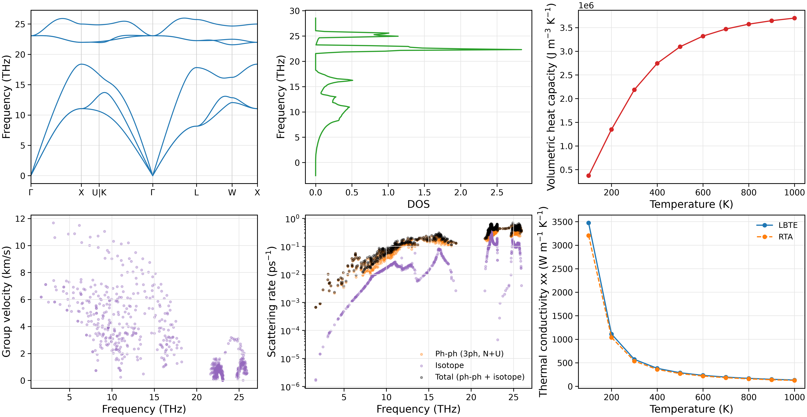
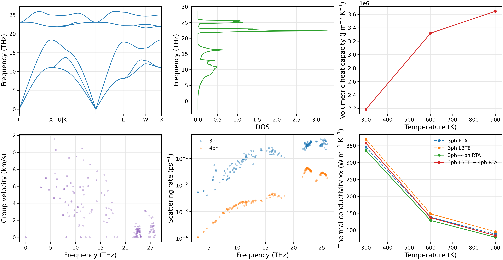
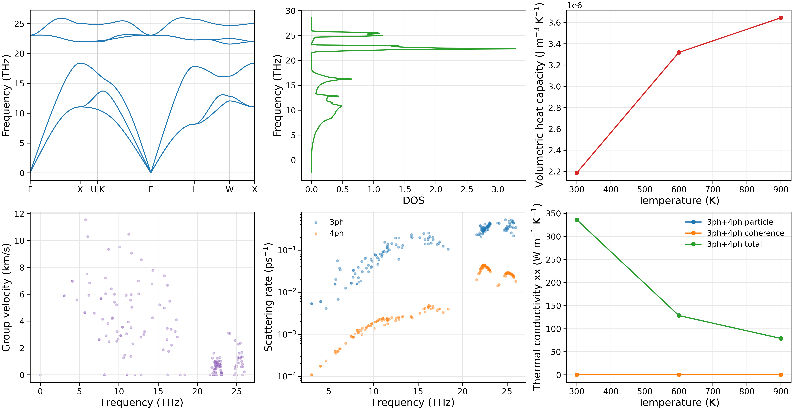

Phonon scattering and lattice thermal conductivity
==================================================

This chapter covers advanced lattice thermal transport: the three-phonon
linearized Boltzmann transport equation (LBTE), combined three- and four-phonon
scattering, and Wigner particle and coherence transport.

Building on the three-phonon RTA example in Chapter 4, these routes account
for mode coupling in collisions, higher-order anharmonic scattering, and
coherence between vibrational modes.

Methods and preparation
------------------------

NEP-kappa provides transport solvers through phono3py and FourPhonon.

.. list-table:: Thermal-transport methods
   :header-rows: 1
   :widths: 26 50 24

   * - Method
     - Main features
     - Engine
   * - Three-phonon LBTE
     - Iteratively solve the linearized BTE, retaining collision coupling between modes.
     - phono3py
   * - Three- and four-phonon transport
     - Include both scattering mechanisms and compare RTA, LBTE and mixed solutions.
     - FourPhonon
   * - Wigner transport
     - Calculate particle, coherence and total conductivity with three- and four-phonon scattering.
     - FourPhonon / Wigner_Park

Continue from the Chapter 4 :doc:`starting` working directory:

.. code-block:: bash

   conda activate nepkappa
   cd ~/work/3C-SiC

Check the structure, potential and force constants:

.. code-block:: bash

   ls results/POSCAR_relaxed
   ls results/fc2.hdf5 results/fc3.hdf5
   ls results/phono3py_disp.yaml
   ls nep_3C-SiC.txt

Use the following calculation sequence:

- **Three-phonon LBTE**: reuse FC2/FC3 from Chapter 4.
- **Four-phonon transport**: generate matching FC2/FC3/FC4 and calculate both
  pure three-phonon and combined three- and four-phonon conductivity.
- **Wigner transport**: reuse those force constants to calculate particle and coherence contributions.

Each calculation uses its own result directory.

Three-phonon LBTE
------------------------

The relaxation-time approximation (RTA) treats the collisions of each mode as
an independent relaxation process. Iterative LBTE retains linearized collision
coupling between modes. Comparing the two reveals the contribution of mode
coupling to conductivity, particularly collective transport associated with
Normal scattering.

Configure the input
~~~~~~~~~~~~~~~~~~~~~~~~

Create ``lbte.yaml``:

.. code-block:: yaml

   kappa:
     force-constants: results
     engine: phono3py
     method: lbte
     mesh: [15, 15, 15]
     temps: [100, 1000, 100]
     isotope: true
     wigner: false

   plot:
     layout: both
     path: seekpath
     tau: total
     scattering-rate-min: 1.0e-8
     temperature: 300
     kappa: x
     dpi: 300

   output:
     result-dir: results/lbte

``force-constants`` selects the force-constant directory generated in Chapter 4,
so no new atomic-force calculations are needed. This example uses a 15×15×15
q mesh and temperatures from 100 to 1000 K in 100 K increments.

Run the calculation
~~~~~~~~~~~~~~~~~~~~~~~~

Check the input and run iterative LBTE:

.. code-block:: bash

   nepkappa info lbte.yaml --for kappa
   nepkappa kappa lbte.yaml

After completion, generate plots:

.. code-block:: bash

   nepkappa plot lbte.yaml

Results are saved in ``results/lbte``.

Results and analysis
~~~~~~~~~~~~~~~~~~~~~~~~

phono3py's iterative LBTE calculation saves both RTA and LBTE conductivities
for direct comparison. The main output is ``kappa-m151515.hdf5``, containing:

- ``kappa_RTA``: relaxation-time approximation conductivity.
- ``kappa``: iterative LBTE conductivity.

Plotting shows both conductivities together and produces dispersion, DOS,
heat-capacity, group-velocity and scattering-rate plots.

   Three-phonon LBTE results for 3C-SiC, including phonon properties,
   scattering rates, and RTA versus iterative LBTE conductivity.

The difference between RTA and LBTE reflects mode coupling omitted by the
independent-relaxation approximation. It depends on Normal scattering,
Umklapp scattering and temperature.

Three- and four-phonon transport
--------------------------------

Three-phonon scattering is described by FC3; four-phonon scattering additionally
requires FC4. Through FourPhonon, NEP-kappa supports RTA, iterative LBTE and
mixed solutions with both mechanisms.

This example uses three-phonon LBTE plus four-phonon RTA and also calculates
a pure three-phonon reference to isolate the effect of four-phonon scattering.

Configure the input
~~~~~~~~~~~~~~~~~~~~~~~~

Prepare Thirdorder, Fourthorder and FourPhonon, and check the executables:

.. code-block:: bash

   command -v thirdorder_vasp.py
   command -v Fourthorder_vasp.py
   command -v ShengBTE_cpu

Create ``fourphonon.yaml``:

.. code-block:: yaml

   structure:
     poscar: results/POSCAR_relaxed
     relaxation: false

   calculator:
     name: nep
     model: nep_3C-SiC.txt

   force-constant:
     dim-fc2: [3, 3, 3]
     dim-fc3: [3, 3, 3]
     fc3-backend: thirdorder
     cutoff-fc3: -3
     format: both

     four-phonon:
       enabled: true
       compare-3ph: true
       dim-fc4: [3, 3, 3]
       cutoff-fc4: -2
       command: ShengBTE_cpu

   kappa:
     engine: fourphonon
     method-3ph: lbte
     method-4ph: rta
     mesh: [8, 8, 8]
     temps: [300, 900, 300]
     isotope: true

   plot:
     layout: both
     path: seekpath
     scattering-rate-min: 1.0e-8
     temperature: 300
     kappa: x
     dpi: 300

   output:
     result-dir: results/fourphonon

   parallel:
     kappa:
       mpi-processes: 4
       omp-threads: 1

NEP provides atomic forces, Thirdorder generates FC3, and Fourthorder generates
FC4. ``cutoff-fc3`` and ``cutoff-fc4`` select the neighbor-shell cutoffs for
third- and fourth-order interactions.

``compare-3ph: true`` enables pure three-phonon and combined three- and
four-phonon calculations. Both use the same structure, FC2, FC3, q mesh,
temperatures, broadening and isotope settings. FC4 is used only in the combined case.

Run the calculation
~~~~~~~~~~~~~~~~~~~~~~~~

.. code-block:: bash

   nepkappa info fourphonon.yaml --for run
   nepkappa run fourphonon.yaml

The workflow generates FC2, FC3 and FC4, then uses the same FourPhonon backend
for two calculations:

1. A reference conductivity including only three-phonon scattering.
2. Conductivity including both three- and four-phonon scattering.

Generate plots after completion:

.. code-block:: bash

   nepkappa plot fourphonon.yaml

Results and analysis
~~~~~~~~~~~~~~~~~~~~~~~~

The following four conductivity solutions can be compared:

.. list-table:: Three- and four-phonon conductivities
   :header-rows: 1
   :widths: 35 65

   * - Method
     - Physical meaning
   * - 3ph RTA
     - Three-phonon scattering only, using RTA.
   * - 3ph LBTE
     - Three-phonon scattering only, using iterative LBTE.
   * - 3ph+4ph RTA
     - Three- and four-phonon scattering, both using RTA.
   * - 3ph LBTE + 4ph RTA
     - Iterative three-phonon LBTE with four-phonon RTA.

Pure three-phonon reference results are saved in:

.. code-block:: text

   results/fourphonon/fourphonon/threephonon/

Combined three- and four-phonon results are saved in:

.. code-block:: text

   results/fourphonon/fourphonon/

Main conductivity files:

- ``kappa3-rta.dat``: pure three-phonon RTA.
- ``kappa3-iterative.dat``: pure three-phonon LBTE.
- ``kappa4-rta.dat``: combined three- and four-phonon RTA.
- ``kappa4-iterative.dat``: three-phonon LBTE plus four-phonon RTA.

The first two are in ``threephonon/``; the last two are in ``fourphonon/``.

   Three- and four-phonon transport in 3C-SiC: conductivity under different
   approximations and a comparison of three- and four-phonon scattering rates.

Plotting separates the three- and four-phonon rates and compares RTA, LBTE
and mixed conductivities. Compare pure and combined scattering to study the
effect of four-phonon processes. Comparing RTA and LBTE separately distinguishes
the effects of scattering mechanisms from those of the collision solver.

Wigner: particle and coherence transport
----------------------------------------

Conventional phonon BTE primarily describes heat flow carried by mode
populations. Wigner transport additionally includes coherence between
different vibrational modes. The conductivity is:

.. math::

   \kappa_{\mathrm{total}}
   = \kappa_{\mathrm{P}}+\kappa_{\mathrm{C}}.

``P`` denotes the particle contribution and ``C`` the coherence contribution.
NEP-kappa supports phono3py SMM19 Wigner calculations and combined three- and
four-phonon Wigner transport through FourPhonon Wigner_Park.

This example uses Wigner_Park with RTA for both three- and four-phonon
scattering to calculate particle, coherence and total conductivity.

Configure the input
~~~~~~~~~~~~~~~~~~~~~~~~

Reuse FC2, FC3 and FC4 from the previous section without recalculating forces
or force constants. Create ``wigner-4ph.yaml``:

.. code-block:: yaml

   structure:
     poscar: results/POSCAR_relaxed
     relaxation: false

   force-constant:
     dim-fc2: [3, 3, 3]
     four-phonon:
       enabled: true
       command: /path/to/FourPhonon-Wigner_Park/ShengBTE
       fc2: results/fourphonon/FORCE_CONSTANTS_2ND
       fc3: results/fourphonon/FORCE_CONSTANTS_3RD
       fc4: results/fourphonon/FORCE_CONSTANTS_4TH

   kappa:
     engine: fourphonon
     method-3ph: rta
     method-4ph: rta
     mesh: [8, 8, 8]
     temps: [300, 900, 300]
     isotope: true
     wigner: true

   plot:
     layout: both
     path: seekpath
     tau: total
     scattering-rate-min: 1.0e-8
     temperature: 300
     kappa: x
     dpi: 300

   output:
     result-dir: results/wigner-4ph

   parallel:
     kappa:
       mpi-processes: 4
       omp-threads: 1

``fc2``, ``fc3`` and ``fc4`` select the ShengBTE-format force constants from
the previous section. ``wigner: true`` enables Wigner_Park coherence transport.
This FourPhonon Wigner route currently uses RTA for both scattering orders.
``command`` must point to the installed Wigner_Park executable.

Run the calculation
~~~~~~~~~~~~~~~~~~~~~~~~

Check the input and calculate:

.. code-block:: bash

   nepkappa info wigner-4ph.yaml --for kappa
   nepkappa kappa wigner-4ph.yaml

After Wigner transport completes, copy matching harmonic data for dispersion
and other phonon-property plots:

.. code-block:: bash

   cp results/fourphonon/fc2.hdf5 results/wigner-4ph/
   cp results/fourphonon/phono3py_disp.yaml results/wigner-4ph/

Then generate plots:

.. code-block:: bash

   nepkappa plot wigner-4ph.yaml

Results and analysis
~~~~~~~~~~~~~~~~~~~~~~~~

Wigner_Park calculates particle, coherence and total conductivities separately:

.. list-table:: Wigner conductivity outputs
   :header-rows: 1
   :widths: 28 72

   * - Contribution
     - Output file
   * - Particle
     - ``kappa4-rta.dat``
   * - Coherence
     - ``kappa4-rta-coherence.dat``
   * - Total
     - ``kappa4-rta-total.dat``

Results are saved in ``results/wigner-4ph/fourphonon/``.
Particle conductivity describes transport from mode populations, whereas
coherence conductivity arises from off-diagonal coupling between vibrational modes.

   Three- and four-phonon Wigner transport in 3C-SiC: particle, coherence
   and total conductivity, with corresponding phonon and scattering properties.

Compare ``kappa_P``, ``kappa_C`` and ``kappa_total`` to assess the relative
importance of particle and coherence transport at different temperatures.
Wigner coherence depends on mode-frequency separations, off-diagonal velocity
matrix elements and phonon linewidths, extending the description of transport
in complex crystals.

Comparing methods and results
-----------------------------

The three routes describe different aspects of thermal transport:

.. list-table:: Comparison of transport methods
   :header-rows: 1
   :widths: 27 38 35

   * - Method
     - Main extension
     - Analysis goal
   * - Three-phonon LBTE
     - Retains mode coupling in the linearized collision operator.
     - Compare RTA and LBTE conductivities.
   * - Three- and four-phonon transport
     - Adds four-phonon scattering to the three-phonon model.
     - Analyze higher-order anharmonic effects on conductivity.
   * - Wigner transport
     - Adds coherence contributions to particle transport.
     - Distinguish particle and coherence heat conduction.

See :doc:`input_files` for further parameters.
