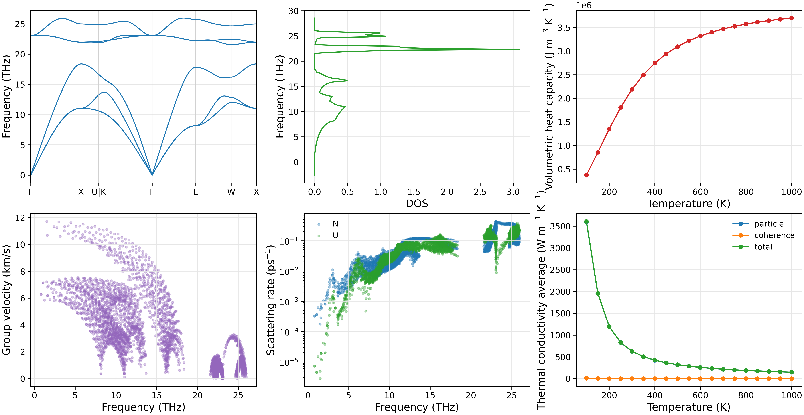

快速开始：三声子热输运
========================

以 3C-SiC 为例，使用仓库提供的 NEP 势函数，完成结构弛豫、二阶和三阶力常数（FC2/FC3）生成，
以及三声子 RTA 热输运计算。

准备工作目录
------------------------

在 NEP-kappa 仓库根目录下执行：

.. code-block:: bash

   conda activate nepkappa
   mkdir -p ~/work/3C-SiC
   cp examples/structures/3C-SiC/POSCAR_primitive ~/work/3C-SiC/POSCAR
   cp examples/potentials/3C-SiC/nep_3C-SiC.txt ~/work/3C-SiC/
   cd ~/work/3C-SiC

工作目录包含晶体结构 ``POSCAR`` 和 NEP 势文件 ``nep_3C-SiC.txt``。
输入文件中的相对路径以运行命令时的工作目录为基准。

配置输入文件
------------------------

创建 ``input.yaml``，内容如下：

.. code-block:: yaml

   # 晶体结构与弛豫
   structure:
     poscar: POSCAR                 # 晶体结构文件
     relaxation: true               # 是否进行结构弛豫

   # 原子力计算
   calculator:
     name: nep                      # 计算器类型：NEP、VASP、MACE 等
     model: nep_3C-SiC.txt          # NEP 势函数文件

   # 力常数生成
   force-constant:
     dim-fc2: [3, 3, 3]             # 二阶力常数超胞
     dim-fc3: [3, 3, 3]             # 三阶力常数超胞

   # 晶格热输运
   kappa:
     engine: phono3py               # 热输运计算引擎
     mesh: [31, 31, 31]             # 声子 q 网格
     temps: [100, 1000, 50]         # 温度：起点、终点、间隔（K）
     method: rta                    # 求解方法：RTA 或 LBTE
     isotope: true                  # 考虑同位素散射
     wigner: true                   # 计算 Wigner 相干贡献

   # 绘图设置
   plot:
     layout: both                   # 生成单独图像和组合图
     path: seekpath                 # 自动生成高对称路径
     tau: total                     # 绘制总散射率及其组成
     temperature: 300               # 散射率绘图温度（K）
     kappa: x                       # 绘制 x 方向热导率
     dpi: 300                       # 图像分辨率

   # 结果输出
   output:
     result-dir: results            # 结果保存目录

.. note::

   示例参数用于演示计算流程。正式研究需要检查力常数超胞 ``dim-fc2`` 和 ``dim-fc3``，
   以及 q 网格密度 ``mesh`` 的收敛性。

运行计算
------------------------

首先检查输入文件：

.. code-block:: bash

   nepkappa info input.yaml --for run

确认配置正确后，执行完整计算：

.. code-block:: bash

   nepkappa run input.yaml

程序将依次完成结构弛豫、FC2/FC3 生成和热输运计算。
终端显示计算进度，详细日志保存至 ``results/run.log``。

如需查看详细终端输出，可添加 ``-v``：

.. code-block:: bash

   nepkappa run input.yaml -v

查看结果
------------------------

计算完成后，生成图像和报告：

.. code-block:: bash

   nepkappa plot input.yaml
   nepkappa report input.yaml

主要结果保存在 ``results/`` 目录中：

.. list-table::
   :header-rows: 1
   :widths: 35 65

   * - 文件
     - 内容
   * - ``fc2.hdf5`` / ``fc3.hdf5``
     - 二阶和三阶力常数。
   * - ``phono3py_disp.yaml``
     - 位移结构及力常数相关信息。
   * - ``kappa-m313131.hdf5``
     - 热导率与模式分辨输运数据。
   * - ``plots/``
     - 声子性质与热输运图像。
   * - ``report.md`` / ``report.yaml``
     - 计算结果摘要。

``layout: both`` 生成单独图像和组合图 ``combined.png``，
包含声子色散、态密度（DOS）、体积定容热容、群速度、声子散射率和晶格热导率。

Wigner 热导率图分别展示粒子项、相干项和总热导率。

   3C-SiC 的声子性质与热输运计算结果，包括声子色散、
   态密度、热容、群速度、散射率及晶格热导率。

温度相关声子计算参见 :doc:`temperature`，更多热输运示例参见 :doc:`thermal_transport`。
