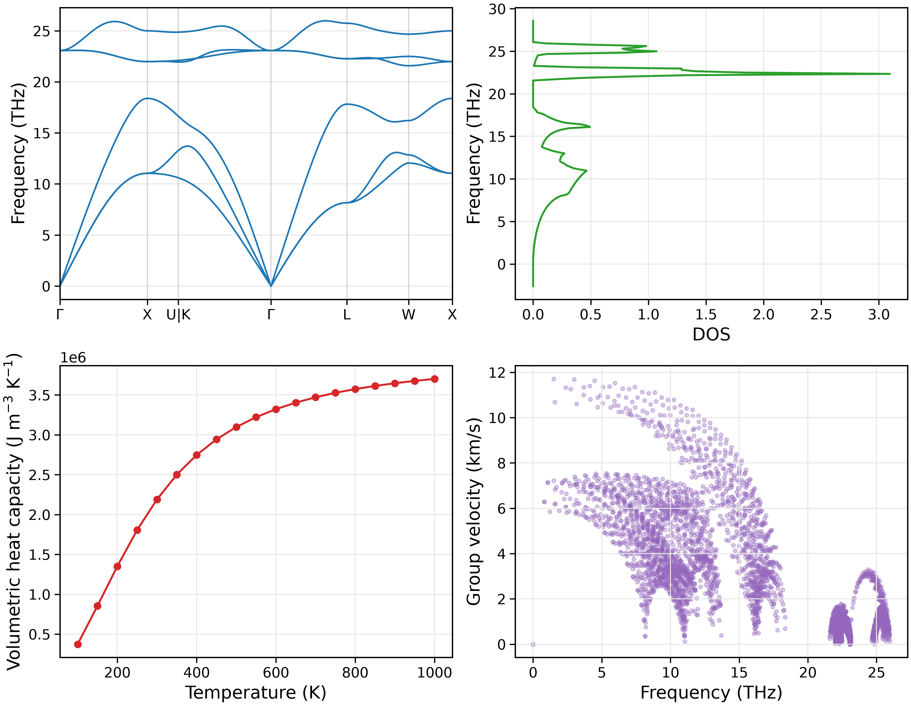

快速开始：声子谱
========================

本教程以 3C-SiC 为例，使用仓库提供的 NEP 势函数，
完成结构弛豫、二阶力常数（FC2）生成，
并计算声子色散、态密度（DOS）、体积定容热容和群速度。

本章仅涉及谐近似声子性质，不计算声子散射与晶格热导率。

准备工作目录
------------------------

在 NEP-kappa 仓库根目录下执行：

.. code-block:: bash

   conda activate nepkappa
   mkdir -p ~/work/3C-SiC
   cp examples/structures/3C-SiC/POSCAR_primitive ~/work/3C-SiC/POSCAR
   cp examples/potentials/3C-SiC/nep_3C-SiC.txt ~/work/3C-SiC/
   cd ~/work/3C-SiC

工作目录中包含晶体结构 ``POSCAR`` 和 NEP 势文件 ``nep_3C-SiC.txt``。
输入文件中的相对路径以运行命令时的工作目录为准。

配置输入文件
------------------------

在工作目录中创建 ``phonons.yaml``，内容如下：

.. code-block:: yaml

   # 晶体结构
   structure:
     poscar: POSCAR                # 结构文件
     relaxation: true              # 进行结构弛豫

   # 原子力计算
   calculator:
     name: nep                     # 使用 NEP 势函数
     model: nep_3C-SiC.txt         # 势文件路径

   # 二阶力常数
   force-constant:
     dim-fc2: [3, 3, 3]            # FC2 超胞

   # 声子性质计算
   kappa:
     mesh: [31, 31, 31]            # 布里渊区 q 网格
     temps: [100, 1000, 50]        # 温度：起点、终点、间隔（K）

   # 绘图设置
   plot:
     layout: both                  # 单独图像和组合图
     path: seekpath                # 自动生成高对称路径
     dpi: 300                      # PNG 分辨率

   # 结果目录
   output:
     result-dir: results/phonons

本例使用 3×3×3 超胞生成 FC2，并采用 31×31×31 q 网格
计算声子态密度及热力学性质。热容的计算温度为 100–1000 K，
间隔 50 K。

这里的 ``kappa`` 模块仅提供声子性质计算与绘图所需的
q 网格和温度设置。使用独立的 ``fc2`` 命令，不会执行声子散射或热导率计算。

运行计算
------------------------

首先检查输入并完成结构弛豫：

.. code-block:: bash

   nepkappa info phonons.yaml --for relax
   nepkappa relax phonons.yaml

随后生成二阶力常数：

.. code-block:: bash

   nepkappa info phonons.yaml --for fc2
   nepkappa fc2 phonons.yaml

最后生成声子性质图：

.. code-block:: bash

   nepkappa info phonons.yaml --for plot
   nepkappa plot phonons.yaml

计算日志保存在 ``results/phonons/run.log``。
如需查看详细终端输出，可在计算命令末尾添加 ``-v``。

查看结果
------------------------

计算完成后，查看力常数及绘图结果：

.. code-block:: bash

   ls -lh results/phonons/fc2.hdf5
   ls results/phonons/plots

主要输出包括二阶力常数 ``fc2.hdf5``、
匹配的结构与位移元数据，以及声子性质图像。

``layout: both`` 将生成四张单独图像和一张组合图 ``combined.png``：

- **声子色散**：沿布里渊区高对称路径的声子频率。
- **声子态密度（DOS）**：声子频率的态分布。
- **体积定容热容**：热容随温度的变化。
- **声子群速度**：不同声子模式的群速度。

其中，``path: seekpath`` 用于确定声子色散的高对称路径，
``mesh`` 用于布里渊区采样，两者作用不同。

   3C-SiC 的谐近似声子性质：声子色散、态密度、
   体积定容热容和群速度。

下一章 :doc:`starting` 将进一步引入三阶力常数（FC3），
计算三声子散射与晶格热导率。
