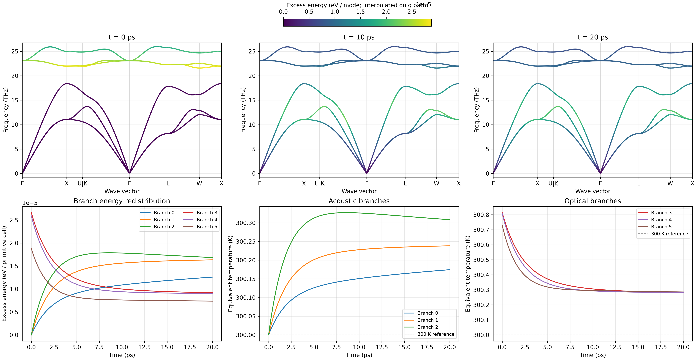

TD-BTE：非平衡声子激发与热化
========================================

NEP-kappa 通过求解含时声子玻尔兹曼输运方程（TD-BTE），
模拟非平衡声子占据数的时间演化以及不同声子模式之间的能量交换。

本章以 3C-SiC 为例，选择性激发光学声子，
研究激发能量如何通过三声子散射传递到声学支，以及声子系统的热化过程。

本章采用空间均匀模型，只考虑声子碰撞引起的非平衡弛豫。
空间传播与声子碰撞共同作用的模型见 :doc:`tdbte_spatial`。

计算方法
------------------------

空间均匀 TD-BTE 描述声子占据数随时间的演化：

.. math::

   \frac{\partial n_\lambda(t)}{\partial t}
   =\mathcal{C}^{3\mathrm{ph}}_\lambda[n(t)].

其中，:math:`n_\lambda` 为声子模式 :math:`\lambda` 的占据数，
:math:`\mathcal{C}^{3\mathrm{ph}}_\lambda` 为非线性三声子碰撞积分。

与稳态热导率计算不同，TD-BTE 直接求解声子占据数的时间变化，
不需要预先计算晶格热导率。

本模型采用固定的声子频率和三声子相互作用强度，
通过时间积分分析模式间能量重新分配。

准备力常数
------------------------

延续第四章 :doc:`starting` 的工作目录：

.. code-block:: bash

   conda activate nepkappa
   cd ~/work/3C-SiC

确认已有配套的 FC2、FC3 和声子元数据：

.. code-block:: bash

   ls results/fc2.hdf5
   ls results/fc3.hdf5
   ls results/phono3py_disp.yaml

FC2 提供声子频率与振动模式，FC3 用于计算三声子相互作用，
``phono3py_disp.yaml`` 提供对应的晶体结构和超胞映射。

本章直接复用这些文件，不再重新计算原子力或力常数。

选择性光学声子激发
------------------------

对于两原子原胞的 3C-SiC，共有六条声子分支，
其中 0–2 为声学支，3–5 为光学支。

本例将三个光学支的初始占据数提高 1%，
随后通过非线性三声子碰撞积分计算能量重新分配。

配置输入
~~~~~~~~~~~~~~~~~~~~~~~~

在工作目录中创建 ``tdbte.yaml``：

.. code-block:: yaml

   # 非平衡声子动力学
   tdbte:
     force-constants: results        # 复用已有 FC2/FC3
     mesh: [6, 6, 6]                # 碰撞积分 q 网格
     temperature: 300               # 初始参考温度（K）
     branches: [3, 4, 5]           # 激发光学支
     excitation: 0.01               # 占据数增加 1%
     duration-ps: 20                # 总演化时间（ps）
     max-step-ps: 0.5               # 最大积分步长（ps）
     samples: 201                   # 保存时刻数量

   # 绘图设置
   plot:
     layout: both                   # 单图和组合图
     path: seekpath                 # 高对称路径
     tdbte-times: [0, 10, 20]       # 声子谱快照时间（ps）
     dpi: 300

   # 结果目录
   output:
     result-dir: results/tdbte-optical

本例使用 6×6×6 的三维 q 网格，共包含 216 个 q 点。
该网格用于构建三声子碰撞积分，与稳态热导率网格相互独立。

``branches`` 指定需要激发的声子分支，编号从零开始，
在各 q 点按频率排序。

``excitation: 0.01`` 表示将所选模式的初始占据数乘以 1.01，
而不是增加 1 K 温度。

初始非平衡分布
~~~~~~~~~~~~~~~~~~~~~~~~

激发前，声子服从 Bose-Einstein 平衡分布：

.. math::

   n_\lambda^0(T_0)
   =
   \frac{1}
   {\exp[\hbar\omega_\lambda/(k_{\mathrm B}T_0)]-1}.

选择性激发后，初始分布为：

.. math::

   n_\lambda(0)=
   \begin{cases}
   (1+A)n_\lambda^0(T_0), & \lambda\in\mathcal S,\\
   n_\lambda^0(T_0), & \lambda\notin\mathcal S,
   \end{cases}

其中，:math:`\mathcal S` 为选定的光学声子模式，
:math:`A=0.01` 为相对激发幅度。

未被激发的模式保持初始平衡分布。
随后系统不再接受外部能量输入，仅通过三声子碰撞进行能量交换。

运行计算
------------------------

检查输入文件并执行 TD-BTE：

.. code-block:: bash

   nepkappa info tdbte.yaml --for tdbte
   nepkappa tdbte tdbte.yaml

程序读取力常数并构建三声子碰撞核，
随后初始化非平衡占据数，求解其时间演化。

求解器采用自适应 DOP853 积分方法。
``max-step-ps`` 限制最大积分步长，
``samples`` 决定保存的时间点数量。

计算结果保存至 ``results/tdbte-optical``，
详细日志记录在 ``run.log`` 中。

结果与分析
------------------------

计算完成后生成图像：

.. code-block:: bash

   nepkappa plot tdbte.yaml

``layout: both`` 生成六张单独图像和一张六面板组合图。

   3C-SiC 的选择性光学声子激发与热化过程。
   上排展示不同时间的模式超额能量分布，
   下排展示分支能量交换及声学、光学支的能量等效温度。

模式能量分布
~~~~~~~~~~~~~~~~~~~~~~~~

组合图上排展示 0、10 和 20 ps 的声子色散。
声子频率保持不变，颜色表示相对于初始平衡态的模式超额能量：

.. math::

   \Delta E_\lambda(t)
   =
   \hbar\omega_\lambda
   [n_\lambda(t)-n_\lambda^0(T_0)].

正值表示该模式相对于参考平衡态获得能量，
负值表示失去能量。

三个快照使用相同色标，
可以比较不同时间声子能量的重新分配。

颜色由 q 网格上的模式能量插值到声子色散路径，
仅用于可视化，不代表重新计算路径上的非平衡占据数。

分支间能量交换
~~~~~~~~~~~~~~~~~~~~~~~~

组合图左下方展示六条声子分支的超额能量：

.. math::

   \Delta E_s(t)
   =
   \frac{1}{N_q}\sum_{\mathbf q}
   \hbar\omega_{\mathbf qs}
   [n_{\mathbf qs}(t)-n_{\mathbf qs}^0(T_0)].

其中，:math:`s` 为声子分支编号，
能量单位为 eV / 原胞。

本例中，初始光学支具有较高的超额能量。
随着时间演化，光学支超额能量减少，
声学支获得能量，反映三声子碰撞导致的模式间能量转移。

由于系统没有外部热浴，
各分支之间可以交换能量，但总能量保持守恒。

声子分支的等效温度
~~~~~~~~~~~~~~~~~~~~~~~~

组合图下排中间和右侧分别展示声学支和光学支的能量等效温度。

各分支的等效温度通过能量匹配定义：

.. math::

   E_s(t)=E_s^{\mathrm{BE}}[T_s(t)].

这里的 :math:`T_s` 表示与该分支实际能量相同的
Bose-Einstein 分布温度，并不意味着该分支内部已达到热平衡。

本例中，光学支的等效温度随时间降低，
声学支的等效温度升高。
这些变化反映了非平衡能量向其他声子模式重新分配的过程。

由于注入的能量保留在系统内部，
最终平衡温度由系统总能量决定，
不要求返回初始的 300 K。

在有限的 20 ps 时间窗口内，
各分支等效温度仍可能存在差异。

主要输出
------------------------

.. list-table:: TD-BTE 结果文件
   :header-rows: 1
   :widths: 38 62

   * - 文件
     - 内容
   * - ``tdbte/trajectories.npz``
     - 声子占据数、时间、频率和分支编号。
   * - ``tdbte/branch-energy.csv``
     - 各声子分支的超额能量。
   * - ``tdbte/audit.json``
     - 能量守恒、平衡态和熵的数值检查。
   * - ``plots/tdbte_combined.png``
     - 六面板非平衡动力学组合图。
   * - ``plots/tdbte_branch_temperature.csv``
     - 各声子分支的能量等效温度。

上述路径均相对于 ``results/tdbte-optical``。

碰撞核复用
------------------------

三声子碰撞核由力常数和 q 网格确定，
可以在不同初始激发条件下重复使用。

例如，将激发幅度从 1% 增大到 2%，
创建 ``tdbte-reuse.yaml``：

.. code-block:: yaml

   tdbte:
     kernel: results/tdbte-optical/tdbte-kernel/manifest.json
     temperature: 300
     branches: [3, 4, 5]
     excitation: 0.02
     duration-ps: 20
     max-step-ps: 0.5
     samples: 201

   output:
     result-dir: results/tdbte-optical-2percent

执行：

.. code-block:: bash

   nepkappa info tdbte-reuse.yaml --for tdbte
   nepkappa tdbte tdbte-reuse.yaml

此时程序使用已有碰撞核，
无需重新生成力常数或三声子碰撞数据。
新的动力学结果保存在独立目录中。

模型与计算范围
------------------------

本章采用空间均匀、固定声子频率的非线性三声子模型，
研究声子模式之间的能量交换和非平衡弛豫。

本章不包含实空间传播。
下一章 :doc:`tdbte_spatial` 将在相同碰撞模型基础上
加入声子群速度和一维实空间输运。
