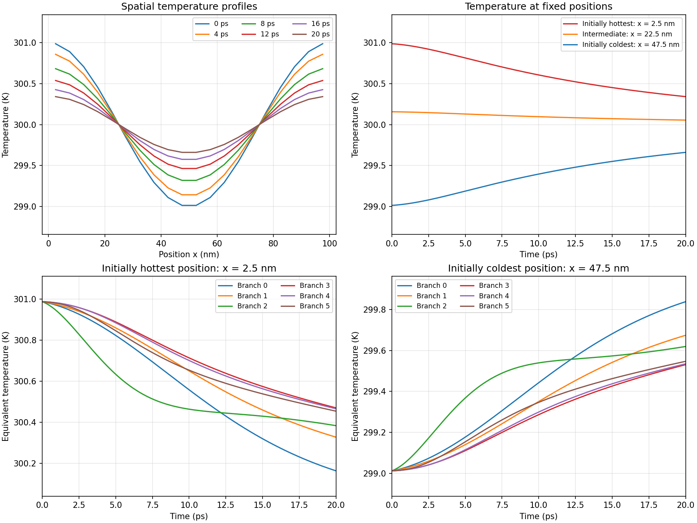

TD-BTE：非平衡声子输运
========================================

上一章通过空间均匀 TD-BTE 研究声子模式之间的能量交换。
本章进一步引入一维实空间坐标，
同时考虑声子传播与非线性三声子碰撞。

NEP-kappa 使用三维声子 q 网格和一维周期实空间网格，
模拟温度、热流和声子分布的时空演化。

本章以 3C-SiC 的瞬态热光栅（TTG）为例，
介绍空间 TD-BTE 的输入、计算方法和结果分析。

计算方法
------------------------

空间 TD-BTE 同时包含声子漂移和碰撞：

.. math::

   \frac{\partial n_\lambda(x,t)}{\partial t}
   +
   v_{\lambda,x}
   \frac{\partial n_\lambda(x,t)}{\partial x}
   =
   \mathcal C_\lambda^{3\mathrm{ph}}[n(x,t)].

其中：

- :math:`n_\lambda(x,t)` 为声子占据数的时空分布。
- :math:`v_{\lambda,x}` 为群速度在输运方向上的分量。
- :math:`\mathcal C_\lambda^{3\mathrm{ph}}` 为非线性三声子碰撞积分。

与空间均匀 TD-BTE 相比，
这里增加了声子漂移项，
用于描述声子携带能量在不同空间位置之间传播。

.. note::

   本章的“一维”指实空间输运方向只有一个，
   声子仍然使用完整三维 q 网格。

瞬态热光栅
------------------------

瞬态热光栅（Transient Thermal Grating, TTG）
使用空间周期性的初始温度分布：

.. math::

   T(x,0)
   =
   T_0+\Delta T
   \cos\left(\frac{2\pi x}{L}\right).

其中，:math:`T_0` 为背景温度，
:math:`\Delta T` 为初始温度调制幅度，
:math:`L` 为温度调制周期。

初始时，各空间单元中的声子服从对应局部温度的 Bose-Einstein 分布。
随后系统在没有持续外部加热的条件下自由演化。

声子传播和碰撞共同作用，
使初始温度分布随时间改变。

准备计算
------------------------

延续前一章的工作目录：

.. code-block:: bash

   conda activate nepkappa
   cd ~/work/3C-SiC

确认已有 FC2、FC3 和声子元数据：

.. code-block:: bash

   ls results/fc2.hdf5
   ls results/fc3.hdf5
   ls results/phono3py_disp.yaml

空间 TD-BTE 使用这些数据计算声子频率、
群速度与三声子碰撞核。

与空间均匀模型一样，
本章不需要预先计算晶格热导率。

配置输入
------------------------

创建 ``tdbte-spatial.yaml``：

.. code-block:: yaml

   # 空间非平衡声子动力学
   tdbte:
     force-constants: results        # 复用已有 FC2/FC3
     mesh: [3, 3, 3]                # 三维声子 q 网格
     temperature: 300               # 背景温度（K）
     duration-ps: 20.0               # 总演化时间（ps）
     max-step-ps: 0.01              # 最大时间步长（ps）
     samples: 201                   # 保存时刻数量

     # 一维实空间输运
     spatial:
       length-nm: 100                # 空间周期长度（nm）
       cells: 20                    # 实空间网格单元数
       direction: [1, 0, 0]        # 笛卡尔输运方向
       boundary: periodic           # 周期边界条件
       cfl: 0.8                     # CFL 数
       batch-size: 20                # 碰撞计算的单元批大小

       # 初始温度分布：瞬态热光栅
       initial:
         profile: ttg
         modes: all
         excitation: temperature
         delta: 1   # 初始温度调制幅度

   # 绘图设置
   plot:
     layout: both
     dpi: 150

   # 结果目录
   output:
     result-dir: results/tdbte-spatial

本例使用 3×3×3 的三维声子 q 网格，
同时沿 x 方向建立长度为 100 nm 的一维周期实空间。

实空间包含 20 个单元，网格间距为：

.. math::

   \Delta x=\frac{L}{N_x}=5\ \mathrm{nm}.

初始温度在 300 K 附近呈余弦分布，
调制幅度为 1 K。总演化时间为 20 ps，每 0.1 ps 保存一次，
共保存 201 个时间点。下方结果图采用相同的 TTG 参数。

主要空间参数
~~~~~~~~~~~~~~~~~~~~~~~~

.. list-table:: 空间 TD-BTE 参数
   :header-rows: 1
   :widths: 36 64

   * - 参数
     - 说明
   * - ``length-nm``
     - 一维周期空间的长度，单位 nm。
   * - ``cells``
     - 实空间网格单元数。
   * - ``direction``
     - 输运方向的笛卡尔向量。
   * - ``boundary``
     - 空间边界条件，目前使用 ``periodic``。
   * - ``cfl``
     - 控制漂移积分稳定性的 CFL 数。
   * - ``threads``
     - 空间单元碰撞并行线程数，默认 1；大于 1 时需要 Numba。
   * - ``batch-size``
     - 碰撞积分的空间单元处理批大小。
   * - ``initial``
     - 初始温度或声子占据数的空间分布。

``length-nm`` 与 ``cells`` 决定实空间网格，
而 ``mesh`` 决定声子碰撞积分所用的 q 网格。
两者分别控制空间分辨率与声子模式分辨率。

运行计算
------------------------

检查输入并执行空间 TD-BTE：

.. code-block:: bash

   nepkappa info tdbte-spatial.yaml --for tdbte
   nepkappa tdbte tdbte-spatial.yaml

程序读取力常数和声子群速度，
构建三声子碰撞核并设置初始温度分布。

随后在各空间单元之间进行声子输运，
同时计算每个单元内部的非线性三声子碰撞。

计算结果保存至 ``results/tdbte-spatial``。

多核碰撞计算
------------------------

空间 TD-BTE 可以在多个 CPU 线程上计算不同空间单元的碰撞积分。
在 ``tdbte.spatial`` 下设置：

.. code-block:: yaml

   threads: 8
   batch-size: 20

各线程处理不同空间单元，共享当前事件分块。
单元内部仍按原有顺序累加散射事件，避免多个线程同时写同一模式的导数。
默认 ``threads: 1`` 使用串行实现；多线程需要 Numba。

结果与分析
------------------------

完成计算后生成图像和报告：

.. code-block:: bash

   nepkappa plot tdbte-spatial.yaml
   nepkappa report results/tdbte-spatial

图像保存在 ``results/tdbte-spatial/plots`` 目录。

   3C-SiC 的 TTG 温度演化：背景温度 300 K、初始调制幅度 1 K，
   空间周期 100 nm、20 个单元、演化时间 20 ps。
   上排为空间温度分布和三个固定位置的总温度演化；
   下排为初始最高温位置（x = 2.5 nm）和最低温位置（x = 47.5 nm）的分支温度。

组合图为 2×2 温度四联图，沿用均匀 TD-BTE 热激发图的实线及分支配色，
不添加面板字母标注：

1. 不同时刻的空间温度分布。
2. 三个固定位置的总温度随时间变化。
3. 初始最高温位置各声子分支的能量等效温度。
4. 初始最低温位置各声子分支的能量等效温度。

三个位置取初始最高温单元、两个极值位置的空间中点附近单元、初始最低温单元，
并在整个轨迹中保持固定。
分支温度从两个极值位置已保存的占据数反演。

``plot.layout: combined`` 生成 ``tdbte_spatial.png`` 和 ``tdbte_spatial.pdf``；
``separate`` 分别输出四幅单图，``both`` 同时输出两种布局。
空间温度分布默认选择覆盖整个轨迹的最多六个等间隔保存时间点，
也可用 ``plot.tdbte-times`` 指定三个时间点。

温度的时空演化
~~~~~~~~~~~~~~~~~~~~~~~~

空间 TD-BTE 输出每个位置和时刻的声子占据数。
程序根据各单元中的总声子热能反演能量等效温度：

.. math::

   E(x,t)=E_{\mathrm{BE}}[T(x,t)].

其中，:math:`T(x,t)` 为局部能量等效温度，
并不要求每个空间单元内部的声子分布已经达到局部平衡。

对于 TTG 初始条件，可以观察周期性温度扰动如何随时间演化。

温度调制的衰减受到声子传播、模式碰撞以及空间尺度的共同影响。

主要输出
------------------------

空间 TD-BTE 将时空分辨结果保存为：

.. code-block:: text

   results/tdbte-spatial/tdbte/spatial.hdf5

.. list-table:: 主要输出数据
   :header-rows: 1
   :widths: 43 57

   * - 数据集
     - 内容
   * - ``occupation``
     - 各位置、时刻和声子模式的占据数。
   * - ``temperature_K``
     - 局部能量等效温度。
   * - ``heat_flux_eV_nm2_ps``
     - 空间分辨声子热流。
   * - ``branch_energy_eV_nm3``
     - 各声子分支的能量密度。
   * - ``branch_heat_flux_eV_nm2_ps``
     - 各声子分支的热流。
   * - ``branch_collision_power_eV_nm3_ps``
     - 三声子碰撞引起的分支间能量交换率。
   * - ``ttg_cosine_amplitude_K``
     - TTG 基频余弦温度幅值。
   * - ``departure_from_local_BE``
     - 与局部等能 Bose 分布的偏离程度。

.. _spatial-initial-conditions:

独立设置初始条件
------------------------

``spatial.initial`` 将空间分布、模式选择和激发方式分开设置：

.. list-table:: 初始条件参数
   :header-rows: 1
   :widths: 25 40 35

   * - 参数
     - 可选值
     - 含义
   * - ``profile``
     - ``ttg``、``gaussian``、``uniform``
     - 空间包络，默认 ``ttg``。
   * - ``modes``
     - ``all``、``branches``、``frequency-window``
     - 模式选择，默认 ``all``。
   * - ``excitation``
     - ``temperature``、``relative``
     - 占据初始化方式，默认 ``temperature``。

三组参数共 18 种组合均受支持。``uniform`` 专指空间均匀，
``all`` 表示所有有效声子模式。分支和频率筛选作用于碰撞核所含的 q 点。

空间分布与占据数
~~~~~~~~~~~~~~~~~~~~~~~~

空间包络 :math:`p(x)` 由 ``profile`` 决定：

- ``ttg``：余弦分布 :math:`p(x)=\cos(2\pi x/L)`。
- ``gaussian``：周期高斯分布，宽度由 ``sigma-nm`` 指定，中心默认为 :math:`L/2`。
- ``uniform``：空间均匀，:math:`p(x)=1`。

温度激发将选中模式设为 :math:`T_0+\delta p(x)` 对应的 Bose 占据；
相对激发将其背景占据数乘以 :math:`1+\delta p(x)`。
未选中的模式保持背景温度 :math:`T_0` 的 Bose 占据。

激发强度
~~~~~~~~~~~~~~~~~~~~~~~~

``delta`` 的含义由 ``excitation`` 决定：

- ``temperature``：温度扰动，单位 K，默认 1 K。
- ``relative``：相对占据变化比例，无量纲，默认 0.01（1%）。

例如 ``delta: 0.2`` 分别表示 0.2 K 或 20%。

指定分支的 TTG 温度激发
~~~~~~~~~~~~~~~~~~~~~~~~

将 ``spatial.initial`` 改为：

.. code-block:: yaml

   initial:
     profile: ttg
     modes: branches
     branches: [3, 4, 5]  # 从 0 编号，需核对材料和碰撞核。
     excitation: temperature
     delta: 10

改为 ``modes: all`` 并删除 ``branches``，即为全模式热 TTG。

指定频率窗口的高斯激发
~~~~~~~~~~~~~~~~~~~~~~~~

.. code-block:: yaml

   initial:
     profile: gaussian
     sigma-nm: 8
     center-nm: 50
     modes: frequency-window
     frequency-range-THz: [10, 15]
     excitation: relative
     delta: 0.2

频率窗口包含两个端点，要求 :math:`0\le f_{min}<f_{max}`。
只有窗口内的有效模式改变占据，在高斯中心增加 20%。
改为 ``profile: uniform`` 并删除高斯参数，即为空间均匀激发。
不同频段采用同一相对增幅时，注入能量一般不同。
