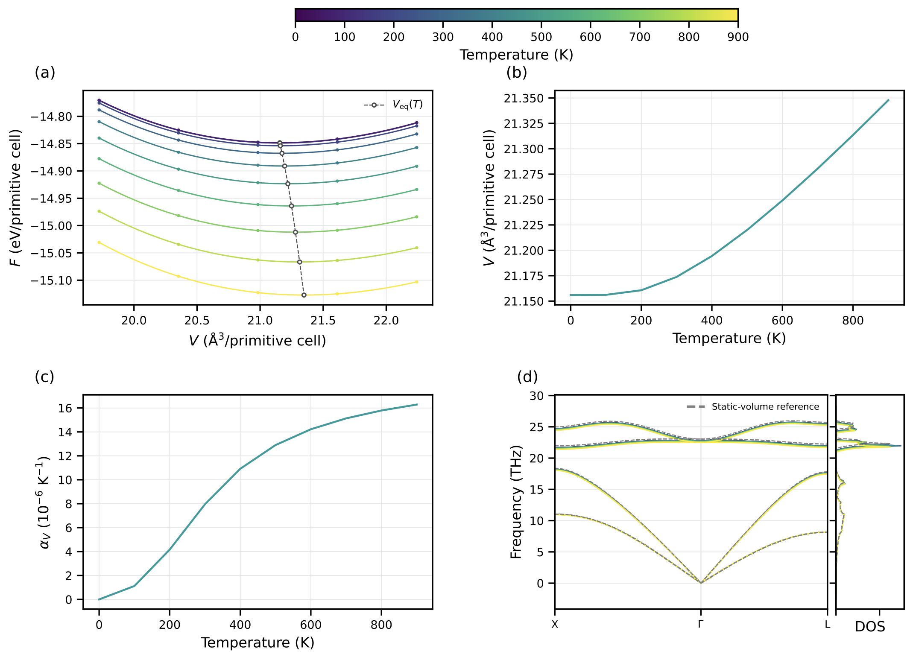
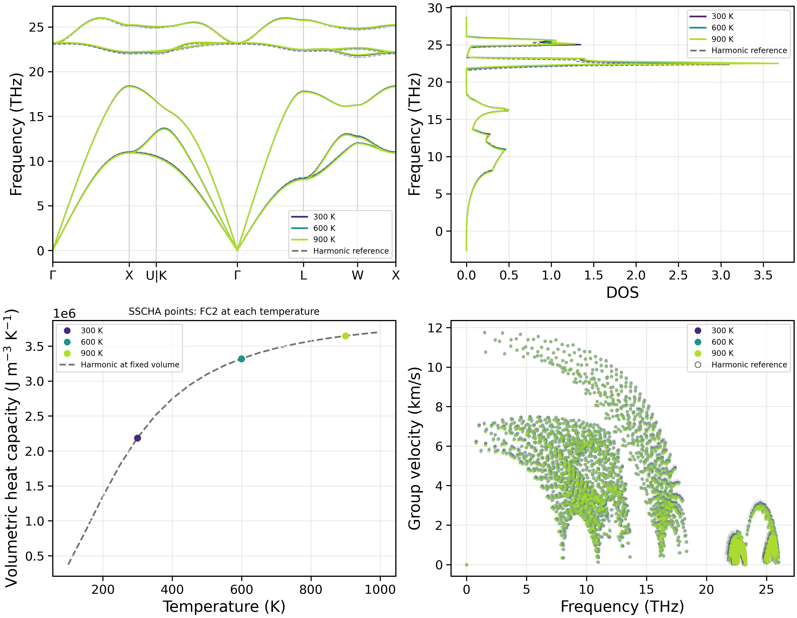
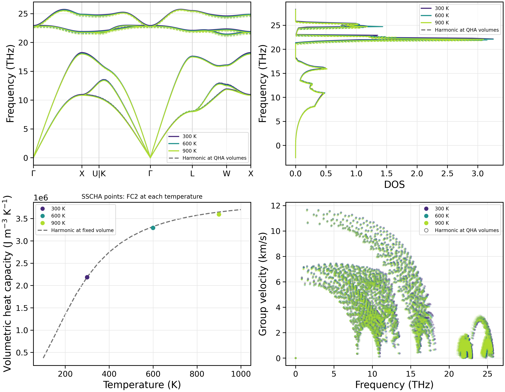

声子的温度重整化
========================

本章介绍 NEP-kappa 中三种温度相关声子计算方法：
准谐近似（QHA）、随机自洽谐近似（SSCHA），
以及 QHA 平衡体积上的 SSCHA。

QHA 通过热膨胀描述声子频率的温度变化；
SSCHA 在固定体积下考虑非简谐相互作用引起的频率重整化；
QHA+SSCHA 则结合两种效应，分析温度相关的声子性质。

本章不计算晶格热导率。普通谐近似声子计算见 :doc:`starting_phonons`。

计算方法与准备
------------------------

.. list-table:: 温度相关声子计算方法
   :header-rows: 1
   :widths: 25 55 20

   * - 方法
     - 主要计算内容
     - 命令
   * - QHA
     - 体积扫描、热膨胀及平衡体积下的声子性质。
     - ``fc2``
   * - SSCHA
     - 固定体积下的非简谐声子频率重整化。
     - ``run``
   * - QHA+SSCHA
     - 在各温度的 QHA 平衡体积上进行 SSCHA。
     - ``run``

延续第三章的工作目录，使用已弛豫的 3C-SiC 结构：

.. code-block:: bash

   conda activate nepkappa
   cd ~/work/3C-SiC
   ls results/phonons/POSCAR_relaxed nep_3C-SiC.txt

三个计算使用相同的 NEP 势函数和初始结构，
结果分别保存至 ``results/qha``、``results/sscha``
和 ``results/qha-sscha``。

所有输入均设置 ``relaxation: false``，
直接使用第三章的弛豫结构，不再重复结构优化。

QHA：热膨胀效应
------------------------

准谐近似（Quasi-Harmonic Approximation, QHA）
通过计算不同体积下的静态能量和声子自由能，
确定温度相关的平衡体积，并分析热膨胀对声子性质的影响。

配置输入
~~~~~~~~~~~~~~~~~~~~~~~~

创建 ``qha.yaml``：

.. code-block:: yaml

   # 晶体结构
   structure:
     poscar: results/phonons/POSCAR_relaxed
     relaxation: false

   # 原子力计算
   calculator:
     name: nep
     model: nep_3C-SiC.txt

   # QHA 设置
   force-constant:
     dim-fc2: [3, 3, 3]
     qha:
       enabled: true
       run-transport: false
       equilibrium-phonons: true
       volume-ratios: [0.94, 0.97, 1.0, 1.03, 1.06]
       mesh: [31, 31, 31]
       temps: [0, 900, 100]
       relax-internal: true

   # 绘图设置
   plot:
     layout: both
     path: custom
     path-points:
       X: [0.5, 0.5, 0.0]
       GAMMA: [0.0, 0.0, 0.0]
       L: [0.0, 0.5, 0.0]
     path-segments: [[X, GAMMA], [GAMMA, L]]
     dpi: 300

   # 结果目录
   output:
     result-dir: results/qha

其中，``volume-ratios`` 指定体积扫描范围，
``mesh`` 为声子布里渊区积分网格，
``temps`` 设置 0–900 K 的计算温度，间隔 100 K。

``relax-internal: true`` 在固定体积下优化内部原子坐标。
``equilibrium-phonons: true`` 在各温度的平衡体积上额外生成 FC2，
用于计算温度相关声子谱。

运行计算
~~~~~~~~~~~~~~~~~~~~~~~~

.. code-block:: bash

   nepkappa info qha.yaml --for fc2
   nepkappa fc2 qha.yaml
   nepkappa plot qha.yaml

程序首先进行体积扫描和自由能拟合，
随后确定各温度的平衡体积，并计算对应的声子性质。

结果与分析
~~~~~~~~~~~~~~~~~~~~~~~~

QHA 通过最小化自由能确定平衡体积：

.. math::

   V_{\mathrm{eq}}(T)
   = \underset{V}{\operatorname{argmin}}
   \left[
   E_{\mathrm{static}}(V)
   + F_{\mathrm{vib}}(T,V)
   + PV
   \right].

本例采用默认零外压条件。

组合图包含四部分：不同温度下的自由能–体积关系、
平衡体积随温度的变化、体积热膨胀系数，
以及温度相关的声子色散与 DOS。

   3C-SiC 的 QHA 计算结果，包括自由能–体积关系、
   平衡体积、体积热膨胀系数和温度相关声子谱。

QHA 中声子频率的温度变化来自平衡体积的改变，
不包含固定体积下显式的非简谐频率重整化。

.. note::

   体积扫描范围应包含所有计算温度下的平衡体积。
   正式研究需要检查体积采样范围、FC2 超胞和声子 q 网格的收敛性。

SSCHA：非简谐频率重整化
------------------------

随机自洽谐近似（Stochastic Self-Consistent Harmonic Approximation, SSCHA）
通过有限温度下的随机原子位移采样和自洽迭代，
构建包含非简谐效应的辅助谐近似模型。

本节保持晶体体积不变，研究温度对声子频率、
态密度和群速度的影响。

配置输入
~~~~~~~~~~~~~~~~~~~~~~~~

创建 ``sscha.yaml``：

.. code-block:: yaml

   # 晶体结构
   structure:
     poscar: results/phonons/POSCAR_relaxed
     relaxation: false

   # 原子力和能量计算
   calculator:
     name: nep
     model: nep_3C-SiC.txt

   # SSCHA 设置
   force-constant:
     dim-fc2: [3, 3, 3]
     sscha:
       enabled: true
       run-transport: false
       temps: [300, 900, 300]
       snapshots: 200
       iterations: 4
       transient: 1
       sscha-mesh: [20, 20, 20]
       random-seed: 7

   # 声子性质采样
   kappa:
     mesh: [31, 31, 31]
     temps: [100, 1000, 50]

   # 绘图设置
   plot:
     layout: both
     path: seekpath
     dpi: 300

   # 结果目录
   output:
     result-dir: results/sscha

本例在 300、600 和 900 K 进行 SSCHA 计算。

``snapshots`` 控制每轮迭代的采样结构数量，
``iterations`` 为自洽迭代次数，
``sscha-mesh`` 为声子采样网格，
``random-seed`` 用于控制随机采样的可复现性。

``kappa`` 模块仅提供声子性质所需的采样设置；
由于 ``run-transport: false``，不执行热导率计算。

运行计算
~~~~~~~~~~~~~~~~~~~~~~~~

.. code-block:: bash

   nepkappa info sscha.yaml --for run
   nepkappa run sscha.yaml
   nepkappa plot sscha.yaml

程序在各温度下进行随机热采样，
通过自洽迭代更新辅助 FC2，
并计算对应的声子性质。

结果与分析
~~~~~~~~~~~~~~~~~~~~~~~~

SSCHA 在各采样温度下得到相应的辅助谐近似力常数。
由此计算的声子频率可以与固定体积谐近似结果比较，
分析温度引起的非简谐重整化。

组合图包含不同温度的声子色散、DOS、体积定容热容和群速度。

   3C-SiC 在固定体积下的 SSCHA 计算结果，
   包括不同温度的声子色散、DOS、体积定容热容和群速度。

色散、DOS 和群速度图叠加不同温度的结果；
热容图使用各温度辅助 FC2 计算的独立数据点，
并与固定体积谐近似参考进行比较。

.. note::

   当前 SSCHA 实现输出的是辅助谐近似 FC2，
   而非自由能 Hessian 或完整的非简谐声子谱函数。

   基于辅助 FC2 计算的热容属于谐模型估计，
   不等于完整 SSCHA 自由能的温度导数。

   计算结果需要检查随机采样数量、自洽迭代次数、
   超胞和采样网格的收敛性。

QHA+SSCHA
----------------------------------------

QHA+SSCHA 将热膨胀与非简谐频率重整化结合，
用于分析各温度平衡体积下的声子性质。

计算先通过 QHA 确定平衡体积，
随后在对应体积和温度下进行固定体积 SSCHA。

配置输入
~~~~~~~~~~~~~~~~~~~~~~~~

创建 ``qha-sscha.yaml``：

.. code-block:: yaml

   # 晶体结构
   structure:
     poscar: results/phonons/POSCAR_relaxed
     relaxation: false

   # 原子力和能量计算
   calculator:
     name: nep
     model: nep_3C-SiC.txt

   # QHA 与 SSCHA
   force-constant:
     dim-fc2: [3, 3, 3]

     # 热膨胀
     qha:
       enabled: true
       run-transport: false
       volume-ratios: [0.94, 0.97, 1.0, 1.03, 1.06]
       mesh: [31, 31, 31]
       temps: [0, 900, 100]
       relax-internal: true

     # 非简谐频率重整化
     sscha:
       enabled: true
       run-transport: false
       temps: [300, 900, 300]
       snapshots: 200
       iterations: 4
       transient: 1
       sscha-mesh: [20, 20, 20]
       random-seed: 7

   # 声子性质采样
   kappa:
     mesh: [31, 31, 31]
     temps: [100, 1000, 50]

   # 绘图设置
   plot:
     layout: both
     path: seekpath
     dpi: 300

   # 结果目录
   output:
     result-dir: results/qha-sscha

QHA 在 0–900 K 范围内确定平衡体积，
SSCHA 在 300、600 和 900 K 进行自洽计算。

SSCHA 温度必须位于 QHA 温度范围内。
程序可以对 QHA 平衡体积进行温度插值。

运行计算
~~~~~~~~~~~~~~~~~~~~~~~~

.. code-block:: bash

   nepkappa info qha-sscha.yaml --for run
   nepkappa run qha-sscha.yaml
   nepkappa plot qha-sscha.yaml

程序先完成 QHA 体积扫描与拟合，
再在各温度对应的 QHA 平衡体积上执行 SSCHA。

结果与分析
~~~~~~~~~~~~~~~~~~~~~~~~

组合计算同时考虑热膨胀与非简谐频率重整化。

声子色散、DOS 和群速度在不同温度下分别计算，
并与相同 QHA 平衡体积下的谐近似声子性质进行比较。

   3C-SiC 的 QHA+SSCHA 计算结果，
   包括不同温度下的声子色散、DOS、
   体积定容热容和群速度，以及对应的谐近似参考。

热容图显示各温度 SSCHA 辅助 FC2 的独立数据点。
灰色谐近似参考曲线使用体积比为 1 的固定体积 QHA 结果。

.. note::

   QHA+SSCHA 不是简单叠加 QHA 和 SSCHA 的频率修正，
   而是在 QHA 平衡体积上进行 SSCHA。
