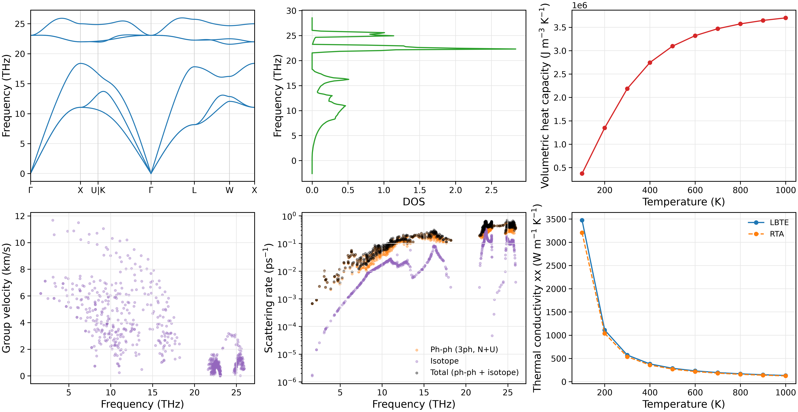
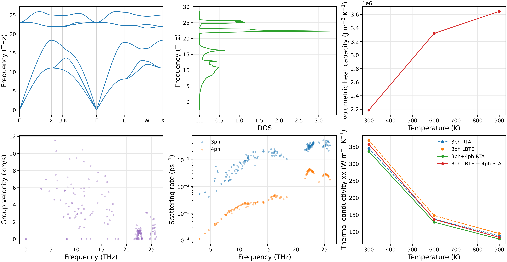
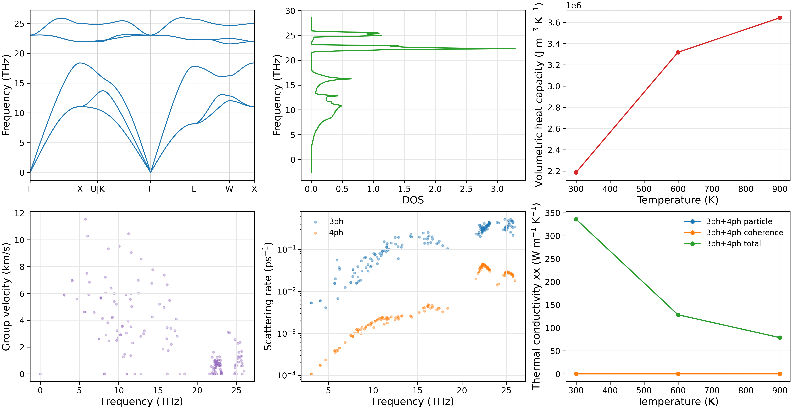

声子散射与晶格热导率
========================

本章介绍 NEP-kappa 的进阶晶格热输运计算，包括三声子线性化玻尔兹曼输运方程（LBTE）、
三声子与四声子联合散射，以及 Wigner 粒子与相干输运。

与第四章的三声子 RTA 计算相比，本章进一步考虑声子模式间的碰撞耦合、
高阶非简谐散射以及不同振动模式之间的相干贡献。

计算方法与准备
------------------------

NEP-kappa 通过 phono3py 和 FourPhonon 提供不同的热输运求解方法。

.. list-table:: 热输运计算方法
   :header-rows: 1
   :widths: 26 50 24

   * - 方法
     - 主要内容
     - 计算引擎
   * - 三声子 LBTE
     - 迭代求解线性化 BTE，考虑声子模式间的碰撞耦合。
     - phono3py
   * - 三声子与四声子输运
     - 计算三声子和四声子散射，比较 RTA、LBTE 及混合求解结果。
     - FourPhonon
   * - Wigner 输运
     - 在三、四声子散射基础上计算粒子项、相干项和总热导率。
     - FourPhonon / Wigner_Park

延续第四章 :doc:`starting` 的工作目录：

.. code-block:: bash

   conda activate nepkappa
   cd ~/work/3C-SiC

确认已有的结构、势函数和力常数：

.. code-block:: bash

   ls results/POSCAR_relaxed
   ls results/fc2.hdf5 results/fc3.hdf5
   ls results/phono3py_disp.yaml
   ls nep_3C-SiC.txt

本章采用以下计算顺序：

- **三声子 LBTE**：复用第四章的 FC2/FC3。
- **四声子输运**：生成配套的 FC2/FC3/FC4，并计算纯三声子与三加四声子热导率。
- **Wigner 输运**：复用四声子计算的力常数，进一步计算粒子和相干贡献。

各计算使用独立的结果目录。

三声子 LBTE
------------------------

弛豫时间近似（RTA）将各声子模式的碰撞项近似为独立的弛豫过程，
而迭代 LBTE 保留不同声子模式之间的线性化碰撞耦合。

通过比较 RTA 与 LBTE，可以分析模式间耦合对晶格热导率的贡献，
尤其是 Normal 散射对集体声子输运的影响。

配置输入
~~~~~~~~~~~~~~~~~~~~~~~~

创建 ``lbte.yaml``：

.. code-block:: yaml

   # 晶格热输运
   kappa:
     force-constants: results       # 复用已有 FC2/FC3
     engine: phono3py              # 计算引擎
     method: lbte                  # 迭代求解 LBTE
     mesh: [15, 15, 15]           # 声子 q 网格
     temps: [100, 1000, 100]       # 温度范围（K）
     isotope: true                 # 同位素散射
     wigner: false                 # 不计算相干项

   # 绘图设置
   plot:
     layout: both                  # 单图与组合图
     path: seekpath                # 高对称路径
     tau: total                    # 声子散射率
     scattering-rate-min: 1.0e-8   # 显示下限（ps^-1）
     temperature: 300              # 散射率绘图温度（K）
     kappa: x                      # xx 方向热导率
     dpi: 300

   # 结果目录
   output:
     result-dir: results/lbte

``force-constants`` 指向第四章已生成的力常数目录，
因此不需要重新计算原子力。

本例采用 15×15×15 的 q 网格，在 100–1000 K 范围内
以 100 K 为间隔计算三声子热导率。

运行计算
~~~~~~~~~~~~~~~~~~~~~~~~

首先检查输入，再执行迭代 LBTE：

.. code-block:: bash

   nepkappa info lbte.yaml --for kappa
   nepkappa kappa lbte.yaml

计算完成后生成图像：

.. code-block:: bash

   nepkappa plot lbte.yaml

结果保存至 ``results/lbte``。

结果与分析
~~~~~~~~~~~~~~~~~~~~~~~~

phono3py 的迭代 LBTE 计算同时保存 RTA 和 LBTE 热导率，
因此可以直接比较两种求解方法。

主要结果为 ``kappa-m151515.hdf5``，其中：

- ``kappa_RTA``：弛豫时间近似热导率。
- ``kappa``：迭代 LBTE 热导率。

绘图程序将 RTA 和 LBTE 结果显示在同一热导率图中，
并生成声子色散、DOS、热容、群速度和散射率等图像。

   3C-SiC 的三声子 LBTE 计算结果，包括声子性质、
   散射率以及 RTA 和迭代 LBTE 热导率的比较。

RTA 与 LBTE 的差异反映了独立弛豫近似忽略的模式间耦合贡献。
这种差异与 Normal 散射、Umklapp 散射及温度有关。

三声子与四声子输运
------------------------

三声子散射由三阶力常数（FC3）描述，
四声子散射则进一步涉及四阶力常数（FC4）。

NEP-kappa 通过 FourPhonon 计算包含三声子和四声子散射的晶格热导率，
支持 RTA、迭代 LBTE 及混合求解。

本例采用三声子 LBTE + 四声子 RTA，
同时计算纯三声子参考结果，用于分析四声子散射对热导率的影响。

配置输入
~~~~~~~~~~~~~~~~~~~~~~~~

首先准备 Thirdorder、Fourthorder 和 FourPhonon，
并确认相关可执行程序：

.. code-block:: bash

   command -v thirdorder_vasp.py
   command -v Fourthorder_vasp.py
   command -v ShengBTE_cpu

创建 ``fourphonon.yaml``：

.. code-block:: yaml

   # 晶体结构
   structure:
     poscar: results/POSCAR_relaxed
     relaxation: false

   # 原子力计算
   calculator:
     name: nep
     model: nep_3C-SiC.txt

   # 力常数生成
   force-constant:
     dim-fc2: [3, 3, 3]            # FC2 超胞
     dim-fc3: [3, 3, 3]            # FC3 超胞
     fc3-backend: thirdorder        # 使用 Thirdorder
     cutoff-fc3: -3                # 三阶邻居壳层截断
     format: both                  # HDF5 与 ShengBTE 格式

     # 四声子散射
     four-phonon:
       enabled: true
       compare-3ph: true           # 同时计算纯三声子参考
       dim-fc4: [3, 3, 3]         # FC4 超胞
       cutoff-fc4: -2             # 四阶邻居壳层截断
       command: ShengBTE_cpu       # FourPhonon 可执行程序

   # 晶格热输运
   kappa:
     engine: fourphonon
     method-3ph: lbte              # 三声子迭代求解
     method-4ph: rta               # 四声子采用 RTA
     mesh: [8, 8, 8]               # 声子 q 网格
     temps: [300, 900, 300]        # 计算温度（K）
     isotope: true                 # 同位素散射

   # 绘图设置
   plot:
     layout: both
     path: seekpath
     scattering-rate-min: 1.0e-8
     temperature: 300
     kappa: x
     dpi: 300

   # 结果目录
   output:
     result-dir: results/fourphonon

   # 并行设置
   parallel:
     kappa:
       mpi-processes: 4            # MPI 进程数
       omp-threads: 1              # OpenMP 线程数

这里由 NEP 提供原子力，Thirdorder 生成 FC3，
Fourthorder 生成 FC4。

``cutoff-fc3`` 和 ``cutoff-fc4`` 分别指定三阶和四阶
相互作用的邻居壳层截断。

``compare-3ph: true`` 启用纯三声子与三加四声子的对照计算。
两组计算使用相同的结构、FC2、FC3、q 网格、
温度、展宽及同位素设置，FC4 仅用于三加四声子计算。

运行计算
~~~~~~~~~~~~~~~~~~~~~~~~

.. code-block:: bash

   nepkappa info fourphonon.yaml --for run
   nepkappa run fourphonon.yaml

程序依次生成 FC2、FC3 和 FC4，
然后使用同一个 FourPhonon 后端计算：

1. 仅包含三声子散射的参考热导率。
2. 同时包含三声子与四声子散射的热导率。

完成后绘图：

.. code-block:: bash

   nepkappa plot fourphonon.yaml

结果与分析
~~~~~~~~~~~~~~~~~~~~~~~~

本例可以比较以下四种热导率：

.. list-table:: 三声子与四声子热导率
   :header-rows: 1
   :widths: 35 65

   * - 计算方法
     - 物理含义
   * - 3ph RTA
     - 仅包含三声子散射，采用 RTA。
   * - 3ph LBTE
     - 仅包含三声子散射，采用迭代 LBTE。
   * - 3ph+4ph RTA
     - 同时包含三、四声子散射，均采用 RTA。
   * - 3ph LBTE + 4ph RTA
     - 三声子采用迭代 LBTE，四声子采用 RTA。

纯三声子参考结果保存于：

.. code-block:: text

   results/fourphonon/fourphonon/threephonon/

三加四声子结果保存于：

.. code-block:: text

   results/fourphonon/fourphonon/

主要热导率文件包括：

- ``kappa3-rta.dat``：纯三声子 RTA。
- ``kappa3-iterative.dat``：纯三声子 LBTE。
- ``kappa4-rta.dat``：三加四声子 RTA。
- ``kappa4-iterative.dat``：三声子 LBTE + 四声子 RTA。

前两项位于 ``threephonon/`` 目录，
后两项位于 ``fourphonon/`` 目录。

   3C-SiC 的三声子与四声子输运结果，包括不同近似下的晶格热导率，
   以及三声子和四声子散射率的比较。

绘图程序分别展示三声子与四声子散射率，
并比较 RTA、LBTE 和混合求解得到的热导率。

通过比较纯三声子与三加四声子的计算结果，
可以分析新增四声子散射对晶格热导率的影响。

同时比较 RTA 和 LBTE，可以区分散射机制与碰撞求解方法
对热导率的不同贡献。

Wigner：粒子与相干输运
------------------------

传统声子 BTE 主要描述声子模式布居所产生的热流。
Wigner 输运进一步考虑不同振动模式之间的相干贡献。

晶格热导率表示为：

.. math::

   \kappa_{\mathrm{total}}
   = \kappa_{\mathrm{P}}+\kappa_{\mathrm{C}}.

其中，``P`` 为粒子贡献（particle），
``C`` 为相干贡献（coherence）。

NEP-kappa 支持 phono3py 的 SMM19 Wigner 计算，
以及 FourPhonon Wigner_Park 的三加四声子 Wigner 输运。

本例使用 Wigner_Park，在三声子和四声子 RTA 散射的基础上，
计算粒子项、相干项与总热导率。

配置输入
~~~~~~~~~~~~~~~~~~~~~~~~

复用上一节生成的 FC2、FC3 和 FC4，
无需重新计算原子力及力常数。

创建 ``wigner-4ph.yaml``：

.. code-block:: yaml

   # 晶体结构
   structure:
     poscar: results/POSCAR_relaxed
     relaxation: false

   # 复用已有力常数
   force-constant:
     dim-fc2: [3, 3, 3]
     four-phonon:
       enabled: true
       command: /path/to/FourPhonon-Wigner_Park/ShengBTE
       fc2: results/fourphonon/FORCE_CONSTANTS_2ND
       fc3: results/fourphonon/FORCE_CONSTANTS_3RD
       fc4: results/fourphonon/FORCE_CONSTANTS_4TH

   # Wigner 热输运
   kappa:
     engine: fourphonon
     method-3ph: rta               # 三声子 RTA
     method-4ph: rta               # 四声子 RTA
     mesh: [8, 8, 8]               # 声子 q 网格
     temps: [300, 900, 300]        # 计算温度（K）
     isotope: true                 # 同位素散射
     wigner: true                  # 启用相干输运

   # 绘图设置
   plot:
     layout: both
     path: seekpath
     tau: total
     scattering-rate-min: 1.0e-8
     temperature: 300
     kappa: x
     dpi: 300

   # 结果目录
   output:
     result-dir: results/wigner-4ph

   # 并行设置
   parallel:
     kappa:
       mpi-processes: 4
       omp-threads: 1

``fc2``、``fc3`` 和 ``fc4`` 指向上一节生成的
ShengBTE 格式力常数。

``wigner: true`` 启用 Wigner_Park 相干输运。
当前 FourPhonon Wigner 路线使用三、四声子 RTA。

``command`` 指向实际安装的 Wigner_Park 可执行程序。

运行计算
~~~~~~~~~~~~~~~~~~~~~~~~

检查输入并执行计算：

.. code-block:: bash

   nepkappa info wigner-4ph.yaml --for kappa
   nepkappa kappa wigner-4ph.yaml

Wigner 热输运计算完成后，复制与力常数匹配的
谐近似数据，用于绘制声子色散和其他声子性质：

.. code-block:: bash

   cp results/fourphonon/fc2.hdf5 results/wigner-4ph/
   cp results/fourphonon/phono3py_disp.yaml results/wigner-4ph/

随后绘图：

.. code-block:: bash

   nepkappa plot wigner-4ph.yaml

结果与分析
~~~~~~~~~~~~~~~~~~~~~~~~

Wigner_Park 分别计算粒子、相干及总热导率。

.. list-table:: Wigner 热导率结果
   :header-rows: 1
   :widths: 28 72

   * - 热导率贡献
     - 输出文件
   * - 粒子项
     - ``kappa4-rta.dat``
   * - 相干项
     - ``kappa4-rta-coherence.dat``
   * - 总热导率
     - ``kappa4-rta-total.dat``

结果保存在 ``results/wigner-4ph/fourphonon/`` 目录。

粒子热导率描述声子模式布居的输运贡献；
相干热导率则来自不同振动模式之间的非对角耦合。

   3C-SiC 的三加四声子 Wigner 输运结果，
   包括粒子贡献、相干贡献及总热导率，
   以及对应的声子性质和散射信息。

通过比较 ``kappa_P``、``kappa_C`` 和 ``kappa_total``，
可以分析不同温度下粒子输运与相干输运的相对贡献。

Wigner 相干贡献与振动模式的频率间隔、
非对角速度矩阵元以及声子谱线宽度有关，
为研究复杂晶体中的晶格热输运提供了补充描述。

计算结果与方法比较
------------------------

三种计算路线分别考虑不同的热输运物理机制：

.. list-table:: 不同输运方法的比较
   :header-rows: 1
   :widths: 27 38 35

   * - 方法
     - 主要改进
     - 分析目标
   * - 三声子 LBTE
     - 保留线性化碰撞算子的模式间耦合。
     - 比较 RTA 与 LBTE 热导率。
   * - 三加四声子输运
     - 在三声子基础上增加四声子散射。
     - 分析高阶非简谐散射对热导率的影响。
   * - Wigner 输运
     - 在粒子输运之外引入相干贡献。
     - 区分粒子与相干热传导。

更多计算参数见 :doc:`input_files`。
